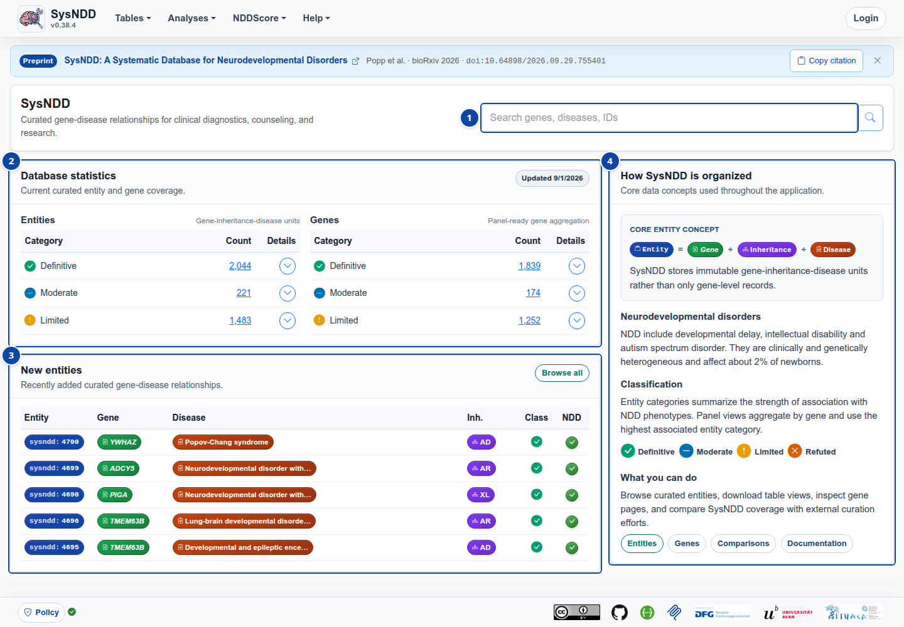
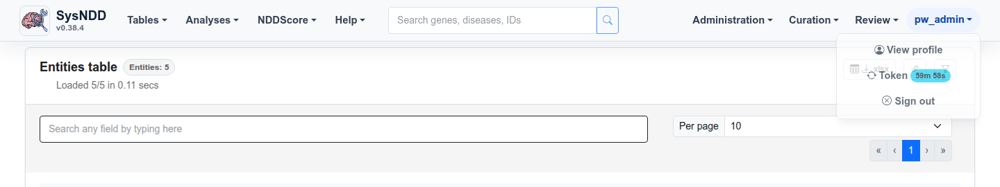
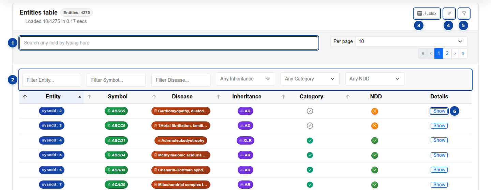

::: {.lead}
A short tour of the SysNDD web app: the home page, the menus, the controls every table shares, and where each task is documented.
:::

::: {.callout-note .who-can title="Who can do this"}
Everyone. The **Review**, **Curation** and **Administration** menus appear only after you sign in with a role that allows them.
:::

## Open SysNDD

Open [https://sysndd.dbmr.unibe.ch/](https://sysndd.dbmr.unibe.ch/) in a current web browser. The short address [https://sysndd.org/](https://sysndd.org/) leads to the same site. The University of Bern hosts SysNDD at its Department for BioMedical Research (DBMR).

All public pages work without an account. You need an account only to review or curate; see [Your account](using-account.qmd).

## The home page

::: {.doc-screenshot}
{#fig-hub-home fig-alt="SysNDD home page. Marker 1 points to the central search box, marker 2 to the Database statistics box with counts per evidence category, marker 3 to the New entities table, marker 4 to the How SysNDD is organized panel."}
:::

::: {.marker-legend}
1. **Search genes, diseases, IDs**: the main search box. See [Find a gene](using-find-gene.qmd).
2. **Database statistics**: entity and gene counts per evidence category. The **Updated** date in the panel header shows when the counts were last refreshed.
3. **New entities**: the most recently added entities. **Browse all** opens the full Entities table.
4. **How SysNDD is organized**: a summary of the entity concept and the evidence categories, explained in [What is SysNDD](01-intro.qmd).
:::

## The menus

The navigation bar at the top is the same on every page. On every page except the home page it also contains a search box.

### Public menus

| Menu | Item | What it opens | Documented in |
| --- | --- | --- | --- |
| **Tables** | **Entities** | All entities, one row per gene, inheritance and disease | [Find a gene](using-find-gene.qmd) |
| | **Genes** | One row per gene with its entities | [Find a gene](using-find-gene.qmd) |
| | **Phenotypes** | Entities filtered by phenotype | [Search by phenotype or variant type](using-phenotype-search.qmd) |
| | **Panels** | Gene lists by category and inheritance | [Build a gene panel](using-panels.qmd) |
| **Analyses** | **Compare curations** | SysNDD compared with other NDD gene lists | [Read the analyses](using-analyses.qmd) |
| | **Correlate phenotypes** | Phenotype co-occurrence, counts and clusters | [Read the analyses](using-analyses.qmd) |
| | **Correlate variants** | Variant-type co-occurrence and counts | [Search by phenotype or variant type](using-phenotype-search.qmd) |
| | **Entries over time** | Growth of SysNDD since curation began | [Read the analyses](using-analyses.qmd) |
| | **NDD Publications** | Publications cited by SysNDD entities | [Read the analyses](using-analyses.qmd) |
| | **PubTator Analysis** | Gene mentions in the NDD literature found by PubTator | [Read the analyses](using-analyses.qmd) |
| | **Functional clusters** | Clusters of interacting gene products | [Read the analyses](using-analyses.qmd) |
| | **Data releases** | Downloadable, versioned analysis releases | [Cite SysNDD and reuse its data](reference-citing.qmd) |
| | **Phenotype–function correlation** | Phenotype clusters compared with functional clusters | [Read the analyses](using-analyses.qmd) |
| **NDDScore** | **Gene predictions** | Machine-learning predictions for genes | Model card in the app |
| | **Model card** | How the predictions were made and their limits | Model card in the app |
| **Help** | **About** | The project, team, funding and contact | — |
| | **Docs and FAQ** | This documentation | — |
| | **MCP** | How to connect an AI assistant | [Get SysNDD data with the API and MCP](03-api.qmd) |

: Public menus in the navigation bar. {#tbl-hub-public-menus}

NDDScore predictions come from a statistical model. They are not curated and are not evidence categories. Read the **Model card** before you use them.

### Menus after sign-in

After you sign in, the right side of the navigation bar shows your user name and the menus your role allows. Each role also sees the menus of the roles below it.

| Menu | Minimum role | Items | Documented in |
| --- | --- | --- | --- |
| **Review** | [Reviewer]{.role} | **Instructions**, **Re-Review** | [Re-review: guide for Reviewers](06-re-review-instructions.qmd) |
| **Curation** | [Curator]{.role} | **Create entity**, **Modify entity**, **Approve review**, **Approve status**, **Approve user**, **Manage re-review**, **Variation suggestions**, **GeneReviews coverage** | Curator guide, starting at [Create an entity](curator-create-entity.qmd) |
| **Administration** | [Administrator]{.role} | See the list below | — |
| *your user name* | any account | **View profile**, **Token**, **Sign out** | [Your account](using-account.qmd) |

: Menus that depend on your role. {#tbl-hub-role-menus}

::: {.doc-screenshot}
{#fig-hub-nav-roles fig-alt="SysNDD navigation bar after sign-in as an Administrator. On the right are the Administration, Curation and Review menus, followed by the user name menu."}
:::

The **Administration** menu is for Administrators who run the site. It contains:

- **Manage user**: user accounts and roles.
- **Manage annotations**: refresh annotation data, such as disease ontologies, from their sources.
- **Manage ontology**: the variation terms used in reviews.
- **Manage about**: the content of the About page.
- **Admin statistics**: curation activity over time.
- **View logs**: the request log of the site.
- **Manage backups**: database backups.
- **Manage PubTator**: the PubTator literature cache.
- **LLM Management**: settings and review of AI-generated summaries.
- **Manage NDDScore**: the imported NDDScore prediction release.
- **Manage releases**: analysis-snapshot releases.
- **Manage metadata**: the controlled vocabularies SysNDD maintains itself.
- **Manage ontology mappings**: mappings between disease ontologies.

If you need something done in one of these areas, write to support [at] sysndd.org.

## Work with tables {#work-with-tables}

The **Entities**, **Genes** and **Phenotypes** tables share the same controls. The Panels page has its own; see [Build a gene panel](using-panels.qmd).

::: {.doc-screenshot}
{#fig-hub-table-controls fig-alt="Entities table. Marker 1 points to the search field above the table, marker 2 to the filter boxes under the column headers, marker 3 to the .xlsx download button, marker 4 to the copy-link button, marker 5 to the funnel button that removes filters, marker 6 to a Show button in the Details column."}
:::

::: {.marker-legend}
1. **Search any field by typing here**: searches all columns at once.
2. **Column filters**: type in a text filter (**Filter** followed by the column name, for example **Filter Symbol...**), or choose a value from a list such as **Any Category** or **Any NDD**.
3. **.xlsx**: downloads all rows that match the current search and filters as an Excel file.
4. **Copy link to this page**: copies a link that reopens the table with the same search, filters and sorting.
5. Funnel button: clears all filters. Its tooltip says whether the table is filtered.
6. **Show**: opens a details row for the entity.
:::

Select a column header to sort by that column. Use **Per page** and the page buttons below the table to move through the results.

Badges in the first columns open the related page. The `sysndd:` badge opens the entity page, the gene symbol opens the gene page, and the disease name opens the disease page. [Find a gene](using-find-gene.qmd) explains these pages.

::: {.callout-tip}
Use **Copy link to this page** to share a filtered view with a colleague or to bookmark a query you repeat.
:::

## The footer

The footer at the bottom of every page has a **Policy** button and links to the data license (CC BY 4.0), the GitHub repository, the API, the MCP page, and the funders and partners.

**Policy** opens the usage policy and data privacy disclaimer. After you acknowledge it, the button's tooltip shows the date you did so.

## Report a problem {#report-a-problem}

Write to support [at] sysndd.org. Include:

- the page address (URL);
- the date, time and browser;
- your role, if you were signed in;
- the steps that reproduce the problem;
- what you expected and what happened instead;
- any error message shown on the page;
- whether the problem repeats after you reload the page.

Do not send passwords, personal data or unpublished patient details, including in screenshots.

A technical problem is easier to trace with the browser's console log. In Chrome or Edge:

::: {.steps}
1. Press <kbd>F12</kbd> to open Developer Tools.
2. Select the **Console** tab.
3. Reproduce the problem.
4. Right-click in the console and save or copy its content.
5. Attach the log to your message.
:::

Other browsers name these menus differently.

## Common problems

- **A menu from this documentation is missing.** The **Review**, **Curation** and **Administration** menus appear only after you sign in with a role that allows them.
- **The search box is not in the navigation bar.** On the home page the search box is in the middle of the page instead.
- **A table looks empty.** A filter may still be active. Select the funnel button to remove all filters.
- **On a phone, menus are hidden.** Select the menu button in the top corner to open them; see [Your account](using-account.qmd#use-sysndd-on-a-phone).

## Related pages

- [Find a gene](using-find-gene.qmd): search, gene pages, entity pages and disease pages.
- [Build a gene panel](using-panels.qmd): download a gene list for variant filtering.
- [Search by phenotype or variant type](using-phenotype-search.qmd): find entities by clinical features.
- [Read the analyses](using-analyses.qmd): comparisons, clusters and publications.
- [Your account](using-account.qmd): apply for an account and sign in.

*Checked against SysNDD 0.38.4 on November 21, 2026.*
