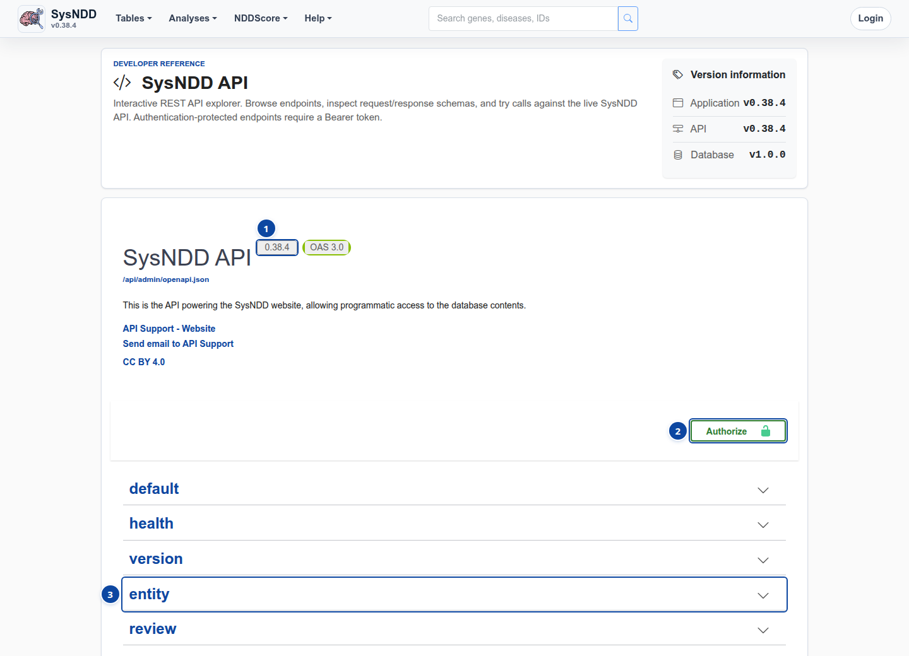
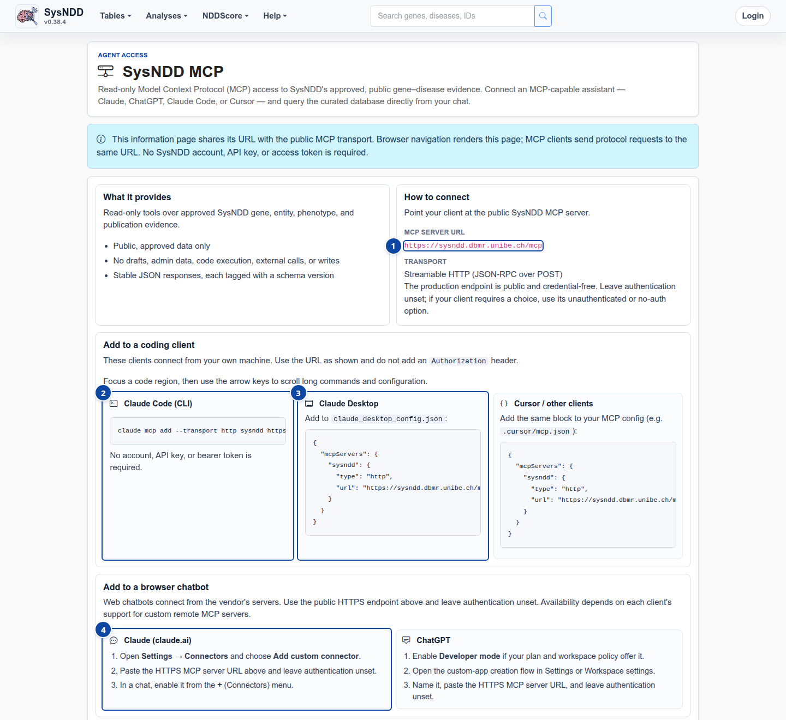
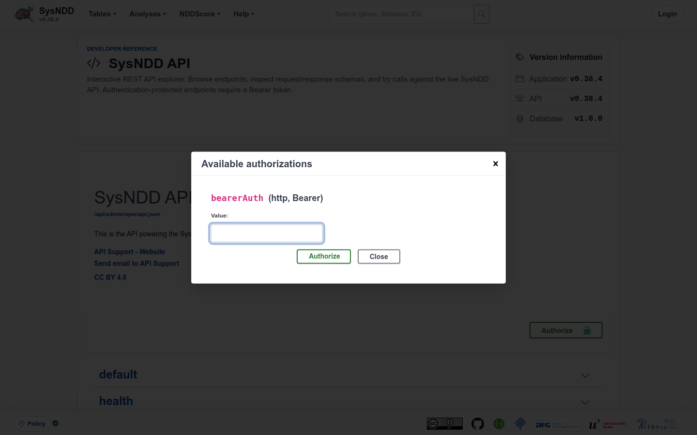

::: {.lead}
Download SysNDD data from a script with the REST (representational state transfer) API, or let an AI assistant read it through
the Model Context Protocol (MCP) server. Both return the same approved, public records that
the web app shows.
:::

::: {.callout-note .who-can title="Who can do this"}
Everyone. Reading public data needs no account, no API key and no token. Only endpoints that
submit, review, curate or administer data need a login (see [Sign in for protected endpoints](#sign-in-for-protected-endpoints)).
:::

## Before you start

You need a tool that sends web requests. The examples use `curl`, which runs in any terminal on
Linux, macOS and Windows. Every example was run against the live API on November 20, 2026.

The API has three addresses worth knowing:

| What | Address |
| --- | --- |
| API base | `https://sysndd.dbmr.unibe.ch/api` |
| Interactive documentation ([Swagger](reference-glossary.qmd#s)) | [Swagger page](https://sysndd.dbmr.unibe.ch/API) |
| Machine-readable description ([OpenAPI](reference-glossary.qmd#o)) | `https://sysndd.dbmr.unibe.ch/api/admin/openapi.json` |

Answers come back as [JSON](reference-glossary.qmd#j) (JavaScript Object Notation), a plain-text
data format. List endpoints can also return an Excel file with `format=xlsx`.

Two URL rules prevent most failed requests:

- **Trailing slash.** A top-level list such as `/api/entity/` needs the closing `/`. Without it,
  the server answers with a redirect (HTTP status 307; HTTP is the protocol of the web). Deeper paths such as `/api/panels/browse` must
  **not** end in `/`, or the server answers "not found" (HTTP 404). Add `-L` to `curl` to follow
  redirects.
- **Encode the query.** Filters contain commas, quotes and spaces. Let `curl` encode them with
  `-G` and `--data-urlencode`, as in the examples below.

## Get all Definitive genes

The panels endpoint returns one row per gene, filtered by evidence category and mode of
inheritance. It is the API version of **Tables › Panels** in the web app (see
[Build a gene panel](using-panels.qmd)).

Without parameters, it returns the genes with at least one [Definitive]{.cat .cat-definitive}
entity, for all modes of inheritance:

```bash
curl -s "https://sysndd.dbmr.unibe.ch/api/panels/browse"
```

Each row in `data` describes one gene:

```json
{
  "category": "Definitive",
  "inheritance": "Autosomal recessive inheritance",
  "symbol": "AARS1",
  "hgnc_id": "HGNC:20",
  "entrez_id": "16",
  "ensembl_gene_id": "ENSG00000090861",
  "ucsc_id": "uc002eyn.2",
  "bed_hg19": "chr16:70286198-70323446",
  "bed_hg38": "chr16:70251983-70289707"
}
```

To narrow the panel, set your own `filter` and pick the columns with `fields`. This request
returns Definitive genes with X-linked inheritance as an Excel file:

```bash
curl -s -G "https://sysndd.dbmr.unibe.ch/api/panels/browse" \
  --data-urlencode "filter=equals(category,'Definitive'),any(inheritance_filter,'X-linked')" \
  --data-urlencode "fields=symbol,hgnc_id,inheritance,category" \
  --data-urlencode "format=xlsx" \
  -o sysndd-definitive-x-linked.xlsx
```

The inheritance groups accepted by `inheritance_filter` are `Autosomal dominant`,
`Autosomal recessive`, `X-linked` and `Other`. By default a gene appears once, under its highest
evidence category (`max_category=true`).

## Get the entities of one gene

A gene can have several entities, one per disease and mode of inheritance (see
[Data model](04-database-structure.qmd)). Filter the entity list by gene symbol:

```bash
curl -s -G "https://sysndd.dbmr.unibe.ch/api/entity/" \
  --data-urlencode "filter=equals(symbol,CHD8)" \
  --data-urlencode "fields=entity_id,symbol,disease_ontology_name,hpo_mode_of_inheritance_term_name,category"
```

```json
{
  "links": [ ... ],
  "meta": [ { "totalItems": 1, ... } ],
  "data": [
    {
      "entity_id": 856,
      "symbol": "CHD8",
      "disease_ontology_name": "Intellectual developmental disorder with autism and macrocephaly",
      "hpo_mode_of_inheritance_term_name": "Autosomal dominant inheritance",
      "category": "Definitive"
    }
  ]
}
```

Gene annotation (identifiers, coordinates, gnomAD constraint) comes from the gene endpoint. Use
the HGNC identifier, or the symbol together with `input_type=symbol`:

```bash
curl -s "https://sysndd.dbmr.unibe.ch/api/gene/HGNC:20153"
curl -s "https://sysndd.dbmr.unibe.ch/api/gene/CHD8?input_type=symbol"
```

## Get the evidence for one entity

Once you know an entity ID, five endpoints return its evidence. Replace `856` with your
entity ID.

| Request | Returns |
| --- | --- |
| `/api/entity/856/review` | clinical synopsis and review date |
| `/api/entity/856/status` | evidence category and status date |
| `/api/entity/856/phenotypes` | HPO terms with their modifier |
| `/api/entity/856/variation` | Variation Ontology (VariO) terms, with provenance for terms suggested from external sources |
| `/api/entity/856/publications` | PubMed IDs and their type |

An empty comment in a review or status is returned as the text `"NA"`, not as `null`.

```bash
curl -s "https://sysndd.dbmr.unibe.ch/api/entity/856/phenotypes"
```

```json
[
  {"entity_id": 856, "phenotype_id": "HP:0000098", "HPO_term": "Tall stature", "modifier_id": 1},
  {"entity_id": 856, "phenotype_id": "HP:0000256", "HPO_term": "Macrocephaly", "modifier_id": 1}
]
```

The `modifier_id` says how the phenotype applies: 1 present, 2 uncertain, 3 variable, 4 rare,
5 absent. The [Data model](04-database-structure.qmd) chapter explains these fields.

## Download the full entity table

`/api/entity/` and `/api/gene/` return 10 rows per page by default; `/api/panels/browse` returns
all rows. Set `page_size=all` to get everything in one response, or page through the results.

To get all Definitive entities in one Excel file:

```bash
curl -s -G "https://sysndd.dbmr.unibe.ch/api/entity/" \
  --data-urlencode "filter=equals(category,Definitive)" \
  --data-urlencode "page_size=all" \
  --data-urlencode "format=xlsx" \
  -o sysndd-definitive-entities.xlsx
```

To page through results instead:

::: {.steps}
1. Send the first request with `page_size` (for example `page_size=100`).
2. Read `meta[0].nextItemID` in the response.
3. Send the same request again with `page_after` set to that value.
4. Repeat until `nextItemID` is `"null"`.
:::

`meta[0].totalItems` tells you how many rows match your filter.

## Filter, sort and choose columns

The list endpoints `/api/entity/`, `/api/gene/` and `/api/panels/browse` share one query
syntax.

| Parameter | Example | Effect |
| --- | --- | --- |
| `filter` | `equals(category,Definitive)` | keep rows where the column has this value |
| `filter` | `any(inheritance_filter,X-linked,Other)` | keep rows matching any listed value |
| `filter` | `contains(any,macrocephaly)` | keep rows where any column contains the text |
| `sort` | `-entity_id` | sort by a column; a leading `-` sorts descending |
| `fields` | `entity_id,symbol,category` | return only these columns |

Combine several filters with commas; a row must match all of them. For example,
`any(category,Moderate,Limited),equals(ndd_phenotype_word,Yes)` keeps Moderate and Limited
entities whose disease is a neurodevelopmental disorder. The filter operations are `equals`, `contains`,
`any`, `all`, `lessThan`, `greaterThan`, `lessOrEqual` and `greaterOrEqual`.

The evidence category values are `Definitive`, `Moderate`, `Limited`, `Refuted` and
`not applicable`. The last one marks entities outside the NDD scope; it is not an evidence
category (see [Glossary](reference-glossary.qmd)).

## Explore all endpoints in Swagger

The Swagger page lists every endpoint with its parameters and lets you send test requests from
the browser.

::: {.steps}
1. Open the [SysNDD API Swagger page](https://sysndd.dbmr.unibe.ch/API).
2. Expand an endpoint group, for example **entity**.
3. Expand an endpoint, select **Try it out**, fill in the parameters and select **Execute**.
4. Copy the generated `curl` command into your own script.
:::

::: {.doc-screenshot}
{#fig-api-swagger-overview fig-alt="Swagger page of the SysNDD API: the title SysNDD API with its version badge, an Authorize button on the right, and the collapsed endpoint groups listed below. Marker 1 points to the version badge, marker 2 to the Authorize button, marker 3 to the entity endpoint group."}
:::

::: {.marker-legend}
1. **Version badge**: the API version; `/api/version/` returns the same value.
2. **Authorize**: enters a token for protected endpoints.
3. **entity**: an endpoint group; expand it to see its endpoints.
:::

The **Version information** card on the same page lists the application, API and database
versions. Report the version when you cite SysNDD (see
[State the version and date you used](reference-citing.qmd#state-the-version-and-date-you-used)).

A selection of the endpoint groups you can use without an account:

| Group | Use it to |
| --- | --- |
| `entity` | list entities and read one entity's review, status, phenotypes, variation and publications |
| `gene` | list genes or read one gene's annotation |
| `panels` | build gene panels by category and inheritance |
| `phenotype`, `variant` | list entities annotated with an HPO phenotype or a VariO term |
| `publication` | read the publications cited by SysNDD entities |
| `nddscore` | read NDDScore machine-learning predictions; these are not evidence categories |
| `search` | resolve free text to genes, diseases and inheritance terms |
| `list` | read the controlled vocabularies (categories, phenotypes, VariO terms) |
| `analysis`, `comparisons`, `statistics` | read precomputed analyses, curation comparisons and summary counts |
| `version`, `health` | check the API version and that the service is up |

Swagger is the complete and current list. Endpoint groups for review, curation, users, jobs and
administration need a login and the matching role.

## Connect an AI assistant with MCP

The MCP server lets an AI assistant such as Claude, ChatGPT, Claude Code or Cursor query SysNDD
during a chat. It is read-only: it returns approved, public records only, and it cannot change
data, run code or call other services.

The server address is:

```text
https://sysndd.dbmr.unibe.ch/mcp
```

No account, API key or token is needed. Leave authentication unset in your client.

::: {.steps}
1. Open **Help › MCP** (`/mcp`).
2. Copy the setup for your client:
   - **Claude Code**: run `claude mcp add --transport http sysndd https://sysndd.dbmr.unibe.ch/mcp`.
   - **Claude Desktop**, **Cursor** and other clients: add the JSON block shown on the page to the
     client's MCP configuration file.
   - **Claude (claude.ai)**: open **Settings → Connectors**, choose **Add custom connector**,
     paste the server address and leave authentication unset. Then, in a chat, enable SysNDD
     from the **+** (**Connectors**) menu.
   - **ChatGPT**: enable **Developer mode** if your plan offers it, create a custom app in the
     settings, name it, paste the server address and leave authentication unset.
3. Ask your assistant a question, for example "Which SysNDD entities exist for *CHD8*?".
:::

::: {.doc-screenshot}
{#fig-api-mcp-page fig-alt="The SysNDD MCP page in the web app. Marker 1 points to the MCP server URL under How to connect, marker 2 to the Claude Code command, marker 3 to the Claude Desktop configuration block, marker 4 to the claude.ai connector steps."}
:::

::: {.marker-legend}
1. **MCP server URL**: the address your client connects to.
2. **Claude Code (CLI)**: a one-line command that registers the server.
3. **Claude Desktop**: the configuration block; Cursor uses the same block.
4. **Claude (claude.ai)**: the steps for a browser chatbot.
:::

The JSON block for Claude Desktop and Cursor is:

```json
{
  "mcpServers": {
    "sysndd": {
      "type": "http",
      "url": "https://sysndd.dbmr.unibe.ch/mcp"
    }
  }
}
```

### What the assistant can look up

The assistant works in four steps. It resolves your text to a gene, disease or phenotype
(`search_sysndd`), reads the gene overview (`get_gene_context`), reads entity evidence
(`get_entities_context`) and fetches the cited publications (`get_publications_context`).

Further tools cover curation comparisons, phenotype analyses and gene networks. The tool
`get_sysndd_capabilities` returns the full, current tool list with limits and examples; the
**MCP** page in the web app groups the tools by purpose.

Every answer is labeled with the kind of data it contains. Curated SysNDD evidence is kept apart
from derived analyses, NDDScore machine-learning predictions and cached summaries generated by a
language model. An NDDScore prediction is not an evidence category.

::: {.callout-warning title="Check the answer against the record"}
An AI assistant can misread or overstate what it retrieves. Before you rely on an answer, open
the entity page it cites and read the evidence yourself. SysNDD supports research and is not
clinical decision support.
:::

### Notes for client developers

The server speaks Streamable HTTP: JSON-RPC requests sent with `POST`. You can test it without
an AI client:

```bash
curl -s -X POST "https://sysndd.dbmr.unibe.ch/mcp" \
  -H "Content-Type: application/json" \
  -d '{"jsonrpc":"2.0","id":1,"method":"tools/list"}'
```

As of November 20, 2026, the server negotiates MCP 2025-11-25 and earlier revisions (2025-06-18,
2025-03-26, 2024-11-05). Clients that implement the newer `2026-07-28` revision should use the
protocol's fallback to an earlier version. The server is stateless: it opens no standalone server-sent event stream and keeps no sessions. A `GET` request with `Accept: text/event-stream` and a `DELETE` request both return HTTP 405. Opening the address in a web browser shows the **MCP** help page instead.

Capacity is shared by all users. If you receive HTTP 429, wait and retry with increasing delays.
A request from a browser with a foreign `Origin` header is rejected with HTTP 403.

## Sign in for protected endpoints

Endpoints that change data need a SysNDD account with the right role (see
[Create and manage your account](using-account.qmd)). The API uses JSON Web Tokens (JWT).

::: {.steps}
1. Request a token with your user name and password in the request body:

   ```bash
   curl -s -X POST "https://sysndd.dbmr.unibe.ch/api/auth/authenticate" \
     -H "Content-Type: application/json" \
     -d '{"user_name":"YOUR_USER","password":"YOUR_PASSWORD"}'
   ```

2. Copy the token from the response.
3. Send it with each request in the header `Authorization: Bearer <token>`. In Swagger, select
   **Authorize** and paste the token.
4. Before the token expires, get a new one from `/api/auth/refresh` with the same header.
:::

With the default configuration a token is valid for 60 minutes. Never put your password in the
URL, and never share a token.

::: {.doc-screenshot}
{#fig-api-swagger-auth fig-alt="Swagger page with the Available authorizations dialog open over the endpoint list, showing a field for the bearer token and an Authorize button."}
:::

## Usage policy

The API serves the web app and is free for everyone who wants to build on SysNDD data. Please
keep the service responsive for others:

- Request what you need. Use filters, `fields` and pages instead of `page_size=all` on large
  lists such as `entity` and `gene`.
- Store results and reuse them until the data changes. The `/api/version/` endpoint reports the
  current release.
- If you need more capacity, contact the team through the **About** page.

The API is provided as is. SysNDD is in version 0.x, so endpoints and response fields can change
between releases. Pin your scripts to the fields you use and check the release notes on
[GitHub](https://github.com/berntpopp/sysndd/releases). The data are licensed under CC BY 4.0;
see [Cite SysNDD and reuse its data](reference-citing.qmd).

## Common problems

- **HTTP 307 instead of data.** The top-level path lacks its trailing slash. Use
  `/api/entity/`, or add `-L` to `curl`.
- **HTTP 404 on a valid endpoint.** A deeper path ends in `/`. Use `/api/panels/browse`, not
  `/api/panels/browse/`.
- **`/api/gene/CHD8` returns `[]`.** A symbol needs `input_type=symbol`. Without it the endpoint
  expects an HGNC ID such as `HGNC:20153`.
- **curl reports "URL rejected" or the filter is ignored.** A value contains spaces or special
  characters. Use `-G` with `--data-urlencode`.
- **Only 10 rows come back from `/api/entity/` or `/api/gene/`.** That is their default page size.
  Set `page_size` or page through the results.
- **HTTP 503 with `snapshot_missing` from an `analysis` endpoint.** No precomputed analysis is
  published at the moment. Try again later; the curated data endpoints are not affected.
- **HTTP 429.** Too many requests across all users. Wait, then retry with increasing delays.

## Related pages

- [Data model](04-database-structure.qmd): what entities, reviews and statuses are, and what
  each field means.
- [Build a gene panel](using-panels.qmd): the same panels in the web app, without code.
- [Curation criteria](05-curation-criteria.qmd): what each evidence category means.
- [Cite SysNDD and reuse its data](reference-citing.qmd): license, citation and releases.
- [Glossary](reference-glossary.qmd): the terms used in responses.
