::: {.lead}
Re-review an entity assigned to you: update its review and its evidence category, then submit both for approval, or hand the entity back when it needs a specialist.
:::

::: {.callout-note .who-can title="Who can do this"}
[Reviewer]{.role} or higher. A [Curator]{.role} assigns the entities you re-review. To get an account, register as described in [Your account](using-account.qmd); a Curator or [Administrator]{.role} then approves it and sets your role.
:::

## How re-review works

The goal of the SysNDD re-review effort is to update and standardize the entities inherited from SysID, the predecessor database, during past years. Standardized entities integrate better with international gene curation efforts and can be exchanged with them.

An entity is one gene, one mode of inheritance and one disease. For each assigned entity you check two records:

- the **review**: synopsis, phenotypes, variation types and publications;
- the **status**: the evidence category ([Definitive]{.cat .cat-definitive}, [Moderate]{.cat .cat-moderate}, [Limited]{.cat .cat-limited} or [Refuted]{.cat .cat-refuted}), or [Not applicable]{.cat .cat-na} for a disorder without intellectual disability (see the rule under [Definitive association status](#definitive-association-status)).

Your work passes through three stages:

1. **Saved.** You save a review or a status. Nothing changes on the public site yet.
2. **Submitted.** You select **Submit entity review**. The entity leaves your list and goes to the Curators.
3. **Approved.** A Curator or Administrator approves your changes. Only then do they appear on the public site.

The rules for choosing an evidence category are in [Curation criteria](05-curation-criteria.qmd). This page gives the rules for the review fields and the checks for each category.

The steps on this page were checked against the SysNDD 0.38.2 source on November 20, 2026.

## Sign in

::: {.steps}
1. Open [SysNDD](https://sysndd.dbmr.unibe.ch/).
2. On your first visit, read the **Usage Policy & Data Privacy** notice and select **Acknowledge and Continue**.
3. Select **Login** at the right end of the menu bar.
4. Type your **Username** and **Password**.
5. Select **Login**.
:::

::: {.doc-screenshot}
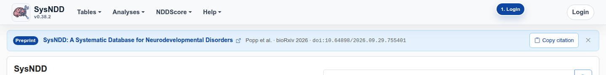{#fig-re-review-login-link fig-alt="SysNDD menu bar for a visitor who is not signed in. The Login link sits at the right end of the bar."}
:::

::: {.doc-screenshot}
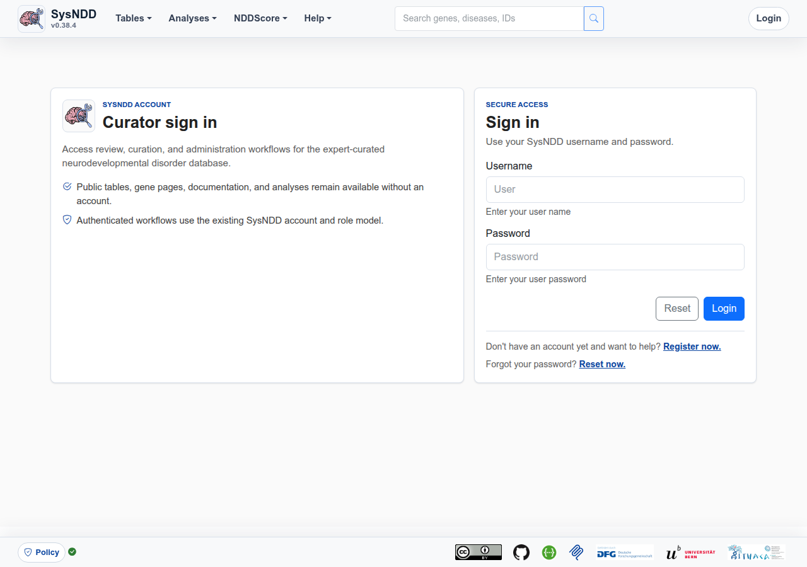{#fig-re-review-login-page fig-alt="SysNDD sign-in page. The left panel is headed Curator sign in. The Sign in form has a Username field, a Password field, Login and Reset buttons, a Register now. link and, after the text Forgot your password?, a Reset now. link."}
:::

SysNDD returns you to the start page. The menu bar now shows a **Review** menu and a menu with your user name. Curators also see **Curation**; Administrators also see **Administration**.

If you have forgotten your password, select **Reset now.** after "Forgot your password?" on the sign-in page. The **Reset** button beside **Login** only clears the form. [Your account](using-account.qmd) explains the reset.

### Keep your session active

A sign-in session lasts 1 hour. After that, SysNDD signs you out.

::: {.steps}
1. Open the menu with your user name.
2. Select **Token**. The badge beside it shows the time left in minutes and seconds, for example `42m 13s`. Selecting **Token** starts a new hour.
:::

::: {.doc-screenshot}
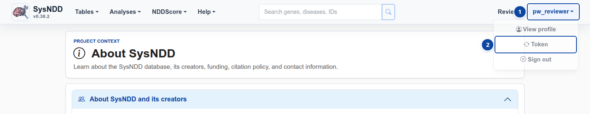{#fig-re-review-token fig-alt="Menu bar of a signed-in Reviewer. The user menu is open and lists View profile, Token and Sign out. Two labeled pills, Reviewer navigation and 1. Token menu, sit on the user menu."}
:::

Five, three and one minute before the end, a **Session ending soon** message appears in the top-right corner for a few seconds. Select **Token** when you see it.

::: {.callout-warning title="Save before your session ends"}
Unsaved text in an open window is lost when the session ends. Save long synopses before the 1-hour limit, or renew the session first.
:::

## Open your re-review list

::: {.steps}
1. Select **Review › Re-Review** (`/Review`).
:::

::: {.doc-screenshot}
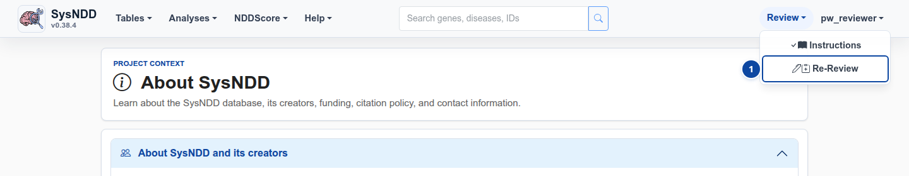{#fig-re-review-menu fig-alt="Open Review menu in the menu bar with two items: Instructions and Re-Review. Two labeled pills, Review menu and 1. Re-Review, sit on the menu."}
:::

**Review › Instructions** (`/ReviewInstructions`) links back to this guide, the curation criteria and the tutorial videos.

The **Re-review** page shows the entities assigned to you, one per row, with the number of entities in the page header.

::: {.doc-screenshot}
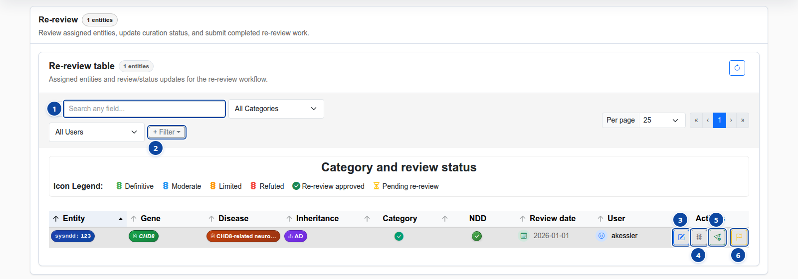{#fig-re-review-table fig-alt="Re-review page with the Re-review table and one entity row. Marker 1 points to the Search any field box, marker 2 to the + Filter menu. In the Actions column, markers 3 to 6 point to the Edit review, Edit status, Submit entity review and Refuse buttons."}
:::

::: {.marker-legend}
1. **Search any field...**: finds rows by gene, disease or any other text.
2. **+ Filter**: quick filters (see below).
3. **Edit review**: opens the review of the entity.
4. **Edit status**: opens the evidence category of the entity.
5. **Submit entity review**: sends your saved work to the Curators. It stays disabled until you save a review.
6. **Refuse / decline (needs specialist)** (flag icon): hands the entity back without changes; see [Refuse a re-review](#refuse-a-re-review-needs-specialist).
:::

The two lists beside the search box filter by category and by user. **+ Filter** offers three quick filters:

- **Pending Review**: no review saved yet.
- **Submitted**: review saved, not yet approved. Despite its name, this filter shows entities still in your list.
- **Needs Status**: no status saved yet.

[Curator]{.role}s also see a **Curation mode** switch, which replaces these buttons with **Approve entity review/status**; see [Approve reviews and statuses](curator-approve.qmd).

Each row shows the **Entity**, **Gene**, **Disease**, **Inheritance**, **Category**, **NDD** (whether the disease is a neurodevelopmental disorder), **Review date** and **User** who wrote the current review. The **Category and review status** legend above the table explains the icons.

Select the entity, gene or disease badge to open its public page. It shows the entity as the public sees it now, before your changes.

### Request a new batch

When your list is empty, a yellow **New batch** badge appears beside **+ Filter**. Clear the search box and all filters first: the badge also appears when a filter hides every row, even if entities are still assigned to you.

::: {.steps}
1. Select **New batch**.
:::

::: {.doc-screenshot}
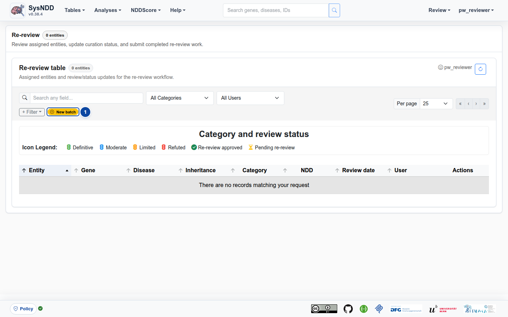{#fig-re-review-after-submit fig-alt="Re-review page with an empty table. A yellow New batch badge sits beside the + Filter menu. Two labeled pills from an older capture lie on the table header and on the New batch badge."}
:::

SysNDD sends your request to the Curators and confirms with "Application send." A Curator assigns the new batch; it appears in your list after you select the refresh button (circular arrow) or reload the page.

## Edit the review

::: {.steps}
1. In the row of the entity, select **Edit review** (marker 3 in @fig-re-review-table). The **Edit Review** window opens with the current review.
2. Revise the **Synopsis** [1]{.marker}. It is required.
3. Add or remove **Phenotypes** [2]{.marker}.
4. Add or remove **Variation ontology** [3]{.marker} terms.
5. Add or remove **Publications** [4]{.marker} by PMID (PubMed identifier).
6. Add the **Genereviews** [5]{.marker} PMID, if a GeneReviews chapter exists.
7. Add a **Comment** [6]{.marker} for the Curator.
8. Select **Save Review** at the bottom of the window.
:::

::: {.doc-screenshot}
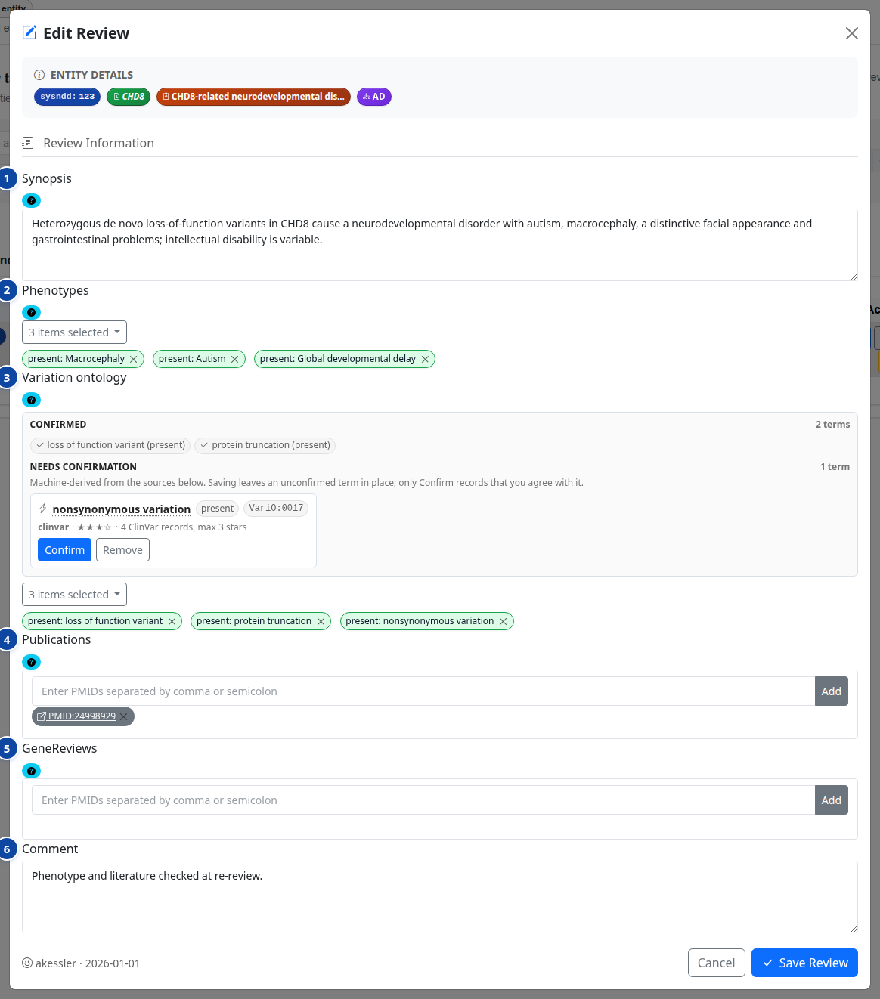{#fig-re-review-edit-review fig-alt="Edit Review window. Markers 1 to 6 sit beside the labels of the Synopsis, Phenotypes, Variation ontology, Publications, Genereviews and Comment fields."}
:::

::: {.marker-legend}
1. **Synopsis**: short clinical and molecular summary of the entity.
2. **Phenotypes**: Human Phenotype Ontology (HPO) terms for the entity.
3. **Variation ontology**: Variation Ontology (VariO) terms for the variant types.
4. **Publications**: PMIDs of the sources for the synopsis.
5. **Genereviews**: PMID of the GeneReviews chapter.
6. **Comment**: a note for the Curator who approves your changes.
:::

SysNDD confirms with "Review submitted successfully". The review is saved, not yet submitted: the **Submit entity review** button (marker 5 in @fig-re-review-table) is now enabled.

If the review needs no change, open **Edit review** and select **Save Review** without editing. This records that you checked the review.

::: {.callout-warning title="Cancel discards your edits"}
The window stays open until the save succeeds, so a failed save keeps your edits. **Edit review** always reloads the saved review from the server, so **Cancel** discards your edits. The window does not close with Esc or a click outside it.
:::

Each field except **Comment** has a question-mark icon. Select it to show the field's instructions. The sections below give the same instructions in full.

### Synopsis

::: {.callout-important .rule title="Rule"}
Short summary for this disease entity. Please include information on:

a) approximate number of patients described in literature,
b) nature of reported variants,
c) severity of intellectual disability,
d) further phenotypic aspects (if possible with frequencies), and
e) any valuable further information (e.g. genotype-phenotype correlations).
:::

Examples:

> *de novo* truncating or missense variants in > 20 individuals: variable ID (mild to severe), 50% short stature and microcephaly, 30% seizures, non-specific facial dysmorphism, variable cardiac and renal anomalies in some

> bi-allelic truncating variants in 7 individuals from 3 families: severe ID, microcephaly, seizures in 3/7, MRI anomalies

In these examples, ID means intellectual disability and MRI means magnetic resonance imaging.

### Phenotypes

::: {.callout-important .rule title="Rule"}
Add or remove associated phenotypes. Only phenotypes that occur in 20% or more of affected individuals should be included. Please also include information on severity of ID where available and applicable.
:::

Open the list and type a term name or an HPO identifier, such as `HP:0001249`, to find a term.

### Variation ontology

::: {.callout-note title="Help text of the field"}
The help text of the field reads: "Please select or deselect the types of variation associated with the disease entity. Minimum information should include "protein truncating variation" and/or "non-synonymous variation". If known, please also select the functional impact of these variations, i.e. if there is a protein "loss-of-function" or "gain-of-function"."
:::

This variant ontology curation guidance standardizes the molecular consequence or mechanism already supported by the source text, so that variants can be compared across entities and analyses. OMIM is Online Mendelian Inheritance in Man.

::: {.callout-important .rule title="Rule: source-based workflow"}
- Read the publication, GeneReviews chapter, OMIM entry, or other accepted source text.
- Identify the variant class or mechanism explicitly supported by that source.
- Select the closest existing SysNDD variation ontology term.
- Prefer a more specific existing term only when the source is explicit.
- Use broader wording or a curator comment when sources are heterogeneous or ambiguous.
- Do not infer a mechanism beyond the source text.
:::

Examples:

- Recurrent missense variants with an explicitly reported gain-of-function mechanism can be captured with the matching existing mechanism or effect term, if present.
- Truncating variants reported as causing loss of function can be captured with the matching existing loss-of-function or truncating concept, if present.
- Mixed missense and truncating reports without a proven common mechanism should be described conservatively in the synopsis or comment, rather than forced into an over-specific ontology assignment.

The authoritative term list is the existing SysNDD variation ontology list, with VariO and the Ontology Lookup Service (OLS) as external references. This documentation does not add or rename terms.

Some entities carry machine-derived terms. The field then shows up to two groups above the list:

::: {.doc-screenshot}
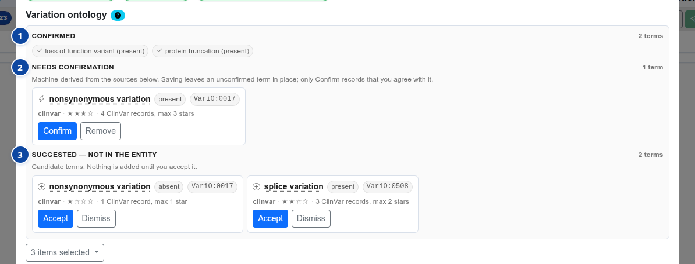{#fig-re-review-variation-zones fig-alt="Variation ontology field with three groups. Marker 1 points to the Confirmed group with two terms, marker 2 to the Needs confirmation group with one term and Confirm and Remove buttons, and marker 3 to the Suggested — not in the entity group with two candidate terms and Accept and Dismiss buttons."}
:::

::: {.marker-legend}
1. **Confirmed**
2. **Needs confirmation**
3. **Suggested — not in the entity** (Curators and Administrators only)
:::

- **Confirmed**: terms a person has already confirmed.
- **Needs confirmation**: machine-derived terms. Select **Confirm** if the source supports the term, or **Remove** if it does not. Saving without a choice leaves the term in place, unconfirmed.

Apply the source-based workflow above to every decision. Confirm a term only when your source states the variant class or mechanism.

[Curator]{.role}s and [Administrator]{.role}s may also see a third group, **Suggested — not in the entity**, with candidate terms to accept or dismiss. [GeneReviews and variation suggestions](curator-genereviews-variation.qmd#review-variation-suggestions) describes it.

### Publications

::: {.callout-important .rule title="Rule"}
No complete catalog of entity-related literature required! If information in the clinical synopsis is not only based on OMIM entries, please include PMID of the article(s) used as a source for the clinical synopsis.
:::

Type each identifier as `PMID:` followed by the number, for example `PMID:32433956`. The number has 5 to 8 digits. A bare number or a link is not accepted. Separate several PMIDs with a comma or semicolon, then select **Add**.

### GeneReviews

::: {.callout-important .rule title="Rule"}
Please add PMID for GeneReview article if available for this entity.
:::

The field is labeled **Genereviews** and uses the same `PMID:` format as **Publications**.

### Find the PMID of a GeneReviews chapter

GeneReviews chapters are hosted in the NCBI (National Center for Biotechnology Information) Bookshelf and may have chapter-specific PubMed records.

::: {.callout-important .rule title="Rule"}
Use the chapter-specific PMID when one exists. Do not substitute the general GeneReviews collection PMID for a chapter-specific citation. If no chapter-specific PMID can be found, note this in the review comment instead of forcing an unrelated PMID.
:::

Two ways to find it:

1. **From GeneReviews or NCBI Bookshelf.** Open the chapter. Check the citation or metadata area near the chapter title or at the foot of the page. Record the PubMed PMID when it is shown.
2. **From PubMed.** Search the condition name plus `GeneReviews`. Open the matching chapter record and copy the PMID from it.

### Comment

Add information about your review that may help the Curator who approves the entity later. For example, say which source supports a changed phenotype, or why you chose a broader variation term.

## Edit the status

The status holds the evidence category of the entity. You propose a category; a Curator approves it.

::: {.steps}
1. In the row of the entity, select **Edit status** (marker 4 in @fig-re-review-table). The **Edit Status** window opens.
2. In **Status Category** [1]{.marker}, choose the category.
3. If the entity should be withdrawn, turn on **Suggest removal of this entity** [2]{.marker}.
4. In **Comment** [3]{.marker}, explain your proposal.
5. Select **Save Status** [4]{.marker}.
:::

The category is required. If the list still shows **Select status...**, saving fails with "Status category is required".

::: {.doc-screenshot}
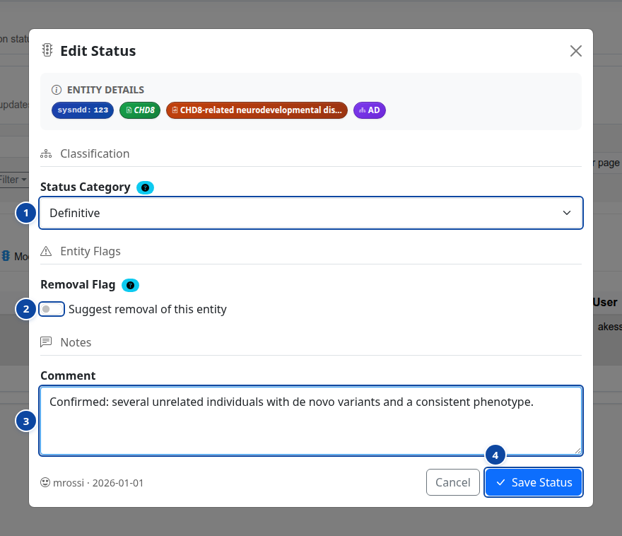{#fig-re-review-edit-status fig-alt="Edit Status window with Definitive chosen and a comment filled in. Marker 1 points to the Status Category list, marker 2 to the Suggest removal of this entity switch, marker 3 to the Comment box and marker 4 to the Save Status button."}
:::

::: {.marker-legend}
1. **Status Category**: Definitive, Moderate, Limited, Refuted or not applicable.
2. **Removal Flag**: **Suggest removal of this entity** proposes that the entity be deactivated.
3. **Comment**: why the status should change.
4. **Save Status**: saves your proposal.
:::

SysNDD confirms with "Status submitted successfully". As with the review, the status is saved but not yet submitted.

**Status Category** and **Removal Flag** each have a question-mark icon. The status help reads "Please refer to the curation manual for details on the categories." The removal help explains deactivation, as summarized below.

Choose the category by the rules in [Curation criteria](05-curation-criteria.qmd). The checks for each category are listed under [What to check for each evidence category](#what-to-check-for-each-evidence-category) below.

::: {.callout-note title="Removal means deactivation"}
SysNDD does not delete entities. A Curator can deactivate one, which hides it from the website. Typically, duplicate entities are deactivated, especially when another entity has a more specific disease name.
:::

## Submit the re-review

Submit an entity when both its review and its status are finished.

**Submit entity review** stays disabled until you save a review for the entity, even an unchanged one. Pointing at the disabled button, or moving to it with <kbd>Tab</kbd>, shows "Save the entity review first (unchanged is fine), then submit".

::: {.callout-warning title="Save a status before you submit"}
SysNDD checks only for a saved review. An entity submitted without a saved status goes to the Curators with its evidence category unchanged. Save a status first if the category needs review.
:::

::: {.steps}
1. In the row of the entity, select **Submit entity review** (marker 5 in @fig-re-review-table).
2. Check the entity identifier in the **Submit Review** window.
3. Select **Submit Review**.
:::

::: {.doc-screenshot}
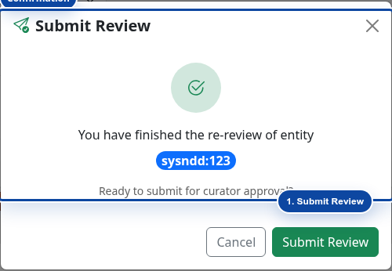{#fig-re-review-submit fig-alt="Submit Review window asking whether the finished re-review of the named entity is ready to submit for curator approval, with Cancel and Submit Review buttons."}
:::

The entity leaves your list. Continue with the remaining entities until your list is empty, then [request a new batch](#request-a-new-batch).

Your changes stay invisible on the public site until a [Curator]{.role} or [Administrator]{.role} approves them. The Curator may approve the review, the status, or both.

## Refuse a re-review (needs specialist)

Some entities are too complex or fall outside your expertise. Instead of forcing a review, refuse the entity. It is flagged for a specialist or a Curator.

::: {.steps}
1. In the row of the entity, select **Refuse / decline (needs specialist)** (flag icon, marker 6 in @fig-re-review-table). The **Refuse re-review** window opens. It names the entity and states that refusing will not change the curated classification.
2. Optional: in **Reason (optional)** [1]{.marker}, give a short reason of up to 1,000 characters, such as "complex inheritance / outside my expertise".
3. Select **Refuse (needs specialist)** [2]{.marker}.
:::

::: {.doc-screenshot}
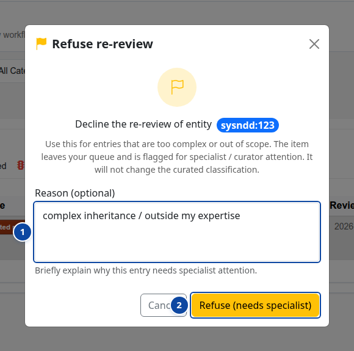{#fig-re-review-refuse fig-alt="Refuse re-review window. Marker 1 points to the Reason (optional) field, which reads complex inheritance / outside my expertise. Marker 2 points to the Refuse (needs specialist) button."}
:::

SysNDD confirms with "Re-review refused and flagged for specialist".

::: {.callout-important .rule title="Rule"}
After you confirm:

- the entry leaves your active queue, so you can continue with the rest of your batch; and
- it is recorded as **refused**: a distinct state that is neither "approved" nor "rejected", and that does **not** change the curated SysNDD classification.

Refusing is reversible by a Curator. If you refuse an entry by mistake, ask a Curator to return it to the queue.
:::

## What to check for each evidence category

Use these checks while you edit the review and the status. They depend on the category the entity has now. The category definitions are in [Curation criteria](05-curation-criteria.qmd).

### Definitive association status

::: {.callout-important .rule title="Rule"}
1. Check if Definitive (Category 1) is correct, or shift the status to Moderate (Category 2) or Limited (Category 3), where appropriate.
2. Check and revise gene-related entities regarding diseases and inheritance patterns (ID and non-ID disorders). Non-ID disorders will not go into any of the categories but will be tagged with "n.a." (not applicable).
3. Check and revise associated phenotypes: select HPO terms from the list, and only use an HPO term if this specific aspect is present in approximately ≥ 20% of patients. Please also check and revise the severity of ID using HPO terms. If ID is very variable, select all appropriate ID terms (e.g. severe, moderate, mild, borderline).
4. Check references (OMIM, PMID, GeneReviews). References do not have to be complete but should be sufficient to give a good impression of the mutational and clinical spectrum. Add references where it would add to the picture.
5. Check and revise the clinical synopsis. It does not have to contain everything that is known, but should give a short and comprehensive picture of:
   - which data the gene and disease category were chosen on, and
   - the molecular and clinical picture.

   Include the information a) to e) listed under [Synopsis](#synopsis): approximate number of patients described in literature, nature of reported variants, severity of intellectual disability, further phenotypic aspects (if possible with frequencies), and any valuable further information (e.g. genotype-phenotype correlations).
:::

In the **Status Category** list, "n.a." is labeled **not applicable**. The synopsis examples under [Synopsis](#synopsis) apply here too.

### Moderate and Limited association status

The checks below call Moderate and Limited entities "candidate genes".

::: {.callout-important .rule title="Rule"}
- Check if the inclusion criteria for candidate genes are still fulfilled, or if the entity should be deleted from the list (Refuted).
- Check if the candidate status is still correct, and sort it into Moderate (Category 2) and Limited (Category 3), or reclassify it to Definitive (Category 1), if applicable.
- Check if the associated phenotype still fits.
- Check if the references are correct and if there is any new published information, and modify the clinical synopsis where appropriate.
- The clinical synopsis can be very short for candidate genes.
- No associated phenotypes (HPO terms) and frequencies are needed for candidate genes, but they could be helpful.
:::

Examples:

> *de novo* missense variants in 2 individuals: autism, ID in 50%

> bi-allelic missense variant in 2 affected individuals from 1 family: moderate ID, MRI anomalies

### Refuted association status

::: {.callout-important .rule title="Rule"}
- Check if there is current evidence against this gene association. Examples: few truncating variants described in old publications before gnomAD constraint scores, and the gene now has a pLI of 0; genes reported in a family with a later report of another cause; etc.
:::

gnomAD is the Genome Aggregation Database. pLI is the probability that a gene is intolerant of loss-of-function variants; a pLI of 0 means the gene tolerates such variants in the general population.

## Refused entries: what Curators do

::: {.callout-note .who-can title="Who can do this"}
[Curator]{.role} or higher.
:::

Curators handle refused entities on **Curation › Manage re-review**; see [Handle refused entities](curator-manage-rereview.qmd#handle-refused-entities). Curators approve submitted re-reviews as described in [Approve reviews and statuses](curator-approve.qmd).

## Common problems

- **A PMID is not accepted.** Type `PMID:` followed by a number of 5 to 8 digits, for example `PMID:32433956`. A bare number or a link is not accepted.
- **Save Review fails with "Cannot save review: Synopsis is required" or "Cannot save review: Synopsis must be at least 10 characters".** Write a synopsis of 10 to 5,000 characters before saving; phenotypes or PMIDs alone cannot be saved. The window stays open with your edits, so you can correct the synopsis and save again.
- **My changes do not show on the entity page.** Saved and submitted changes stay private until a Curator approves them. Check that you selected **Submit entity review** after saving.
- **I was signed out while editing.** Sessions last 1 hour. The **Session ending soon** message shows only for a few seconds, so it is easy to miss. Renew with **Token** in your user menu before the time in its badge runs out.
- **My list is empty.** You have submitted or refused every assigned entity, or a filter hides every row. Clear the search box and filters; if the list stays empty, select **New batch** to ask for more.
- **The Submit entity review button is disabled.** You have not saved a review for this entity yet. Open **Edit review** and select **Save Review**, unchanged if nothing needs editing.
- **A variation term stays after I saved.** Terms under **Needs confirmation** remain until you select **Confirm** or **Remove**.
- **I refused an entity by mistake.** Ask a Curator to return it to the queue.

## Related pages

- [Curation criteria](05-curation-criteria.qmd): the rules for each evidence category.
- [Researching a gene](curation-research.qmd): how to find and read the literature for a review.
- [Tutorial videos](07-tutorial-videos.qmd): the Reviewer tutorial video.
- [Your account](using-account.qmd): register, sign in and reset your password.
- [Glossary](reference-glossary.qmd): terms and abbreviations used in curation.
