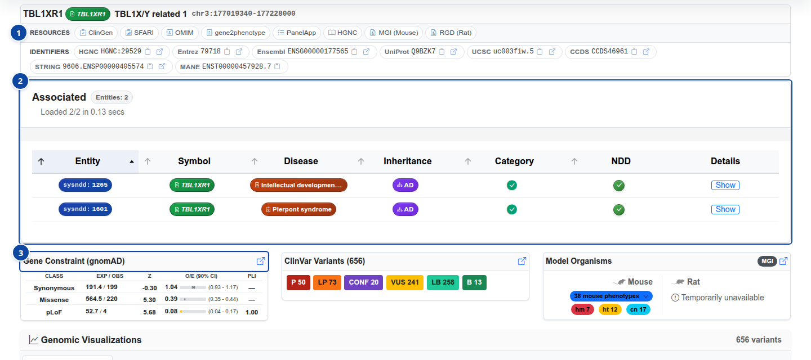
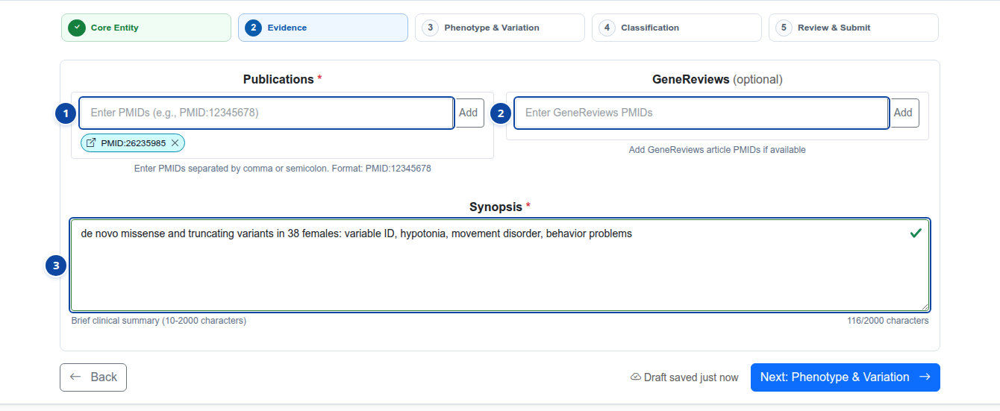

::: {.lead}
Find the published evidence for a gene, read each paper for the facts the curation
criteria weigh, and know where each fact goes in SysNDD.
:::

::: {.callout-note .who-can title="Who can do this"}
Everyone can use this method. It is written for a [Reviewer]{.role} preparing a
re-review and for a [Curator]{.role} preparing a new or modified entity. Entering the
result needs a Reviewer or Curator account.
:::

This chapter teaches method, not rules. The rules that decide a category are in
[Curation criteria](05-curation-criteria.qmd). The rules for a review, such as which
phenotypes to enter and what a synopsis contains, are in
[Re-review instructions](06-re-review-instructions.qmd).

The examples use *TBL1XR1* for researching a gene and *DDX3X* for reading a paper. Both
are already curated in SysNDD.

## Check what SysNDD already has

Start in SysNDD. The gene may already have entities, and your work may be an update
rather than a new entry.

::: {.steps}
1. Type the gene symbol, for example *TBL1XR1*, in the search bar and select the gene.
2. Under **Resources** [1]{.marker}, open the links you need for context: Online
   Mendelian Inheritance in Man (OMIM), ClinGen, gene2phenotype, PanelApp and Simons
   Foundation Autism Research Initiative (SFARI) Gene.
3. Read the **Associated** entities table [2]{.marker}. Each row is one gene, one mode
   of inheritance and one disease, with its evidence category.
4. Open each entity and read its synopsis and publications. Note the date of the last
   review.
5. Read the **Gene Constraint (gnomAD)** card [3]{.marker}. Note the probability of
   loss-of-function intolerance (pLI) and the observed/expected (o/e) values for
   loss-of-function and missense variants.
:::

@fig-curation-research-gene-page shows these three places.

::: {.doc-screenshot}
{#fig-curation-research-gene-page fig-alt="SysNDD gene page for TBL1XR1. Marker 1 points to the Resources row of external links. Marker 2 points to the table of associated entities. Marker 3 points to the Gene Constraint (gnomAD) card."}
:::

::: {.marker-legend}
1. **Resources**: links to the gene in OMIM, ClinGen, SFARI, gene2phenotype, PanelApp,
   the HUGO Gene Nomenclature Committee (HGNC) and model organism databases.
2. **Associated**: the table of the gene's existing entities, one per disease and mode
   of inheritance.
3. **Gene Constraint (gnomAD)**: how tolerant the gene is to loss-of-function and
   missense variants. Several criteria refer to these scores.
:::

You now know which entities exist and how old their evidence is. A gene with two
disorders, such as *TBL1XR1* with an intellectual developmental disorder and Pierpont
syndrome, needs one assessment per entity.

## Find the literature

### Search PubMed

Search PubMed for case reports, case series and cohort studies. Start broad and narrow
down. Restrict the gene symbol to title and abstract to avoid papers that only list it
in a table.

| Goal | Example query |
| --- | --- |
| All papers on the gene and a neurodevelopmental disorder (NDD) | `TBL1XR1[tiab] AND (intellectual disability OR developmental delay OR autism)` |
| Case reports and series | `TBL1XR1[tiab] AND (case reports[pt] OR patients[tiab] OR individuals[tiab]) AND (intellectual disability OR developmental delay)` |
| A named disorder | `"Pierpont syndrome"[tiab]` |
| New papers since the last review | add `AND <year of last review>:3000[dp]` |

Also search the previous gene symbols and aliases listed in HGNC. Older papers may use
them.

::: {.callout-tip}
Large sequencing studies of NDD cohorts often report a gene only in supplementary
tables. If the gene is known from such a study, open its supplement and search for the
symbol.
:::

### Read the curated summaries

Use curated summaries to find the key papers and the disease name. Then read the papers
themselves.

- **OMIM** gives the disease entries for the gene, their phenotype numbers and the
  papers that defined them. The OMIM number usually becomes the disease of the entity.
- **GeneReviews** gives a clinical overview with phenotype frequencies, if a chapter
  exists. Note the chapter's own PMID.
- **MONDO** (Mondo Disease Ontology) covers diseases that have no OMIM entry. The
  **Disease** field in SysNDD searches OMIM and MONDO terms together.

### Check other curation resources for context

ClinGen, the Gene Curation Coalition (GenCC), Gene2Phenotype, PanelApp and SFARI curate
many of the same genes. Their classifications tell you where to look and whether
experts disagree.

Do not copy their category. Each resource uses its own criteria and scope. SysNDD
categories follow [Curation criteria](05-curation-criteria.qmd) only. The
**Curation comparisons** page (**Analyses › Compare curations**) shows how SysNDD and
other resources rate the same genes.

### Follow preprints to publication

Preprints on bioRxiv and medRxiv often describe new genes months before publication.
The criteria allow a preprint to be considered individually, entered by its digital
object identifier (DOI) in the comment field.

::: {.steps}
1. Open the preprint page. bioRxiv and medRxiv show a "Now published in" link once the
   paper is out.
2. If there is no link, search PubMed for the title and the first author.
3. If a published version exists, use its PMID and read the published text. Numbers
   often change between versions.
4. If you find a preprint DOI in an existing entity, check whether it has since been
   published and replace it with the PMID.
:::

### Find patients reported more than once

Count each affected individual and each family once. The same patients often appear in
several papers:

- a case report, then the same patient in a later case series;
- a large cohort study, then a detailed clinical paper on its cases;
- one family described by two groups, or in a paper and its follow-up.

To match patients across papers, compare the variant (complementary DNA (cDNA) and protein change), sex,
age at report, family structure and the source cohort. Read the methods and the
acknowledgments: case series often state which individuals were "previously reported".
When you cannot exclude an overlap, count conservatively and say so in the synopsis.

## Read a paper for curation

Read the methods, the patient table and the supplement, not only the abstract. Patient
tables carry the counts that the criteria weigh.

### What to extract

| Extract | Why it matters | Where it goes in SysNDD |
| --- | --- | --- |
| Number of affected individuals and unrelated families | Frequency criteria | **Synopsis** |
| Mode of inheritance: autosomal dominant, autosomal recessive, X-linked | Defines the entity | **Inheritance** |
| Variant origin and zygosity: *de novo* (confirmed by parental testing), inherited, bi-allelic | Frequency criteria | **Synopsis** |
| Variant types: missense, truncating, splice, copy number; recurrent or clustered variants | Strong genetic criteria | **Variation Ontology**; **Synopsis** |
| Segregation, especially over several generations | Moderate criterion | **Synopsis** |
| Functional data: cell, animal or enzyme studies | Moderate criterion | **Synopsis** |
| Phenotypes with their frequency, and the severity of intellectual disability | Scope; strong clinical criteria | **Phenotypes**; **Synopsis** |
| Disease name and identifier (OMIM or MONDO) | Defines the entity | **Disease** |
| Whether intellectual disability or another NDD is present | Scope | **NDD Phenotype** |
| Gene constraint (gnomAD) and population frequency of the variants | Strong genetic and possible negative criteria | **Synopsis**, with the gnomAD version |
| Confounders: a second diagnosis, a reclassified variant | Possible negative criteria | **Synopsis** or **Comment** |
| The paper's PMID; a GeneReviews chapter PMID | Source of the review | **Publications**; **GeneReviews** |

: What to extract from a paper. {tbl-colwidths="[38,27,35]"}

Phenotypes are entered as Human Phenotype Ontology (HPO) terms. Enter only phenotypes
that meet the frequency threshold in
[Re-review instructions](06-re-review-instructions.qmd). Variant types are entered as Variation Ontology (VariO) terms.

When the paper gives counts, a fraction ("5/20 seizures") keeps the denominator, and
later readers can merge it with new cohorts. Percentages, as in the example synopsis in
[Re-review instructions](06-re-review-instructions.qmd), are also accepted.

### Worked example: *DDX3X*

Snijders Blok et al. (2015), "Mutations in *DDX3X* are a common cause of unexplained
intellectual disability with gender-specific effects on Wnt signaling", *American
Journal of Human Genetics* ([PMID:26235985](https://pubmed.ncbi.nlm.nih.gov/26235985/),
open access). The abstract gives:

- **Individuals**: 38 females with intellectual disability and 35 unique deleterious
  *de novo* variants found by exome sequencing.
- **A second mode of inheritance**: three families with missense variants segregating
  in males with intellectual disability. Carrier females were unaffected.
- **Phenotypes**: hypotonia, movement disorders, behavior problems, corpus callosum
  hypoplasia and epilepsy. Take their frequencies from the patient tables.
- **Functional data**: zebrafish experiments showing a loss-of-function effect of the
  tested *de novo* variants on Wnt signaling.

One paper, two entities. The *de novo* variants in females belong to the X-linked
dominant entity ([entity 1395](https://sysndd.dbmr.unibe.ch/Entities/1395)). The
families with affected males belong to the X-linked recessive entity
([entity 3470](https://sysndd.dbmr.unibe.ch/Entities/3470)). Both are Definitive by
clear-cut frequency; [Curation criteria](05-curation-criteria.qmd) works through the
counts.

As of November 20, 2026, the X-linked recessive synopsis reports seven affected males from four families,
one family more than this paper. Evidence accumulates across papers in this way: add
new families to the count, but count each one only once.

## Record the result

What you enter depends on your role and on whether the entity exists.

- **The entity exists and is assigned to you for re-review.** A [Reviewer]{.role}
  updates its review and status. See [Re-review instructions](06-re-review-instructions.qmd).
- **The entity exists and you are a Curator.** A [Curator]{.role} can update its review
  or status in **Curation › Modify entity**. See [Modify an entity](curator-modify-entity.qmd).
- **The entity is new.** A [Curator]{.role} creates it in **Curation › Create entity**.
  The steps are **Core Entity**, **Evidence**, **Phenotype & Variation**,
  **Classification** and **Review & Submit**. See [Create an entity](curator-create-entity.qmd).

In the **Evidence** step (@fig-curation-research-evidence-step), enter the papers under
**Publications** [1]{.marker}, a GeneReviews chapter under **GeneReviews** [2]{.marker}
and your summary under **Synopsis** [3]{.marker}.

::: {.doc-screenshot}
{#fig-curation-research-evidence-step fig-alt="Create entity wizard at the Evidence step. Marker 1 points to the Publications field with one PMID tag, marker 2 to the optional GeneReviews field, marker 3 to the Synopsis text area with its character counter."}
:::

::: {.marker-legend}
1. **Publications**: PMIDs of the papers your synopsis is based on, in the form
   `PMID:12345678`. At least one is required.
2. **GeneReviews**: the PMID of the GeneReviews chapter, if one exists. Optional.
3. **Synopsis**: the clinical summary, 10 to 2,000 characters.
:::

A submitted review or status becomes public only after a Curator approves it.

## Common problems

- **The counts in two papers add up to more patients than exist.** The later paper
  probably includes earlier cases. Compare variants and individual details before you
  add counts.
- **The abstract and the tables give different numbers.** Use the patient tables. Note
  in the synopsis if individuals were excluded or unclear.
- **The paper reports a gene but no patient data.** Evidence from function or
  experiments without human variants falls under the exclusion criteria in
  [Curation criteria](05-curation-criteria.qmd).
- **The only source is a preprint.** A preprint can be considered individually. If you
  use it, enter its DOI in the comment field and recheck later for a PMID.
- **Another resource rates the gene differently.** Apply the SysNDD criteria to the
  evidence you found. Mention a relevant disagreement in the comment for the approving
  Curator.

## Related pages

- [Curation criteria](05-curation-criteria.qmd): the rules that turn your evidence into
  an evidence category.
- [Re-review instructions](06-re-review-instructions.qmd): how a Reviewer records the
  result for an existing entity.
- [Create an entity](curator-create-entity.qmd): how a Curator records a new entity.
- [Modify an entity](curator-modify-entity.qmd): how a Curator changes an existing
  entity outside re-review.
- [Find a gene](using-find-gene.qmd): the gene and entity pages in detail.
- [Glossary](reference-glossary.qmd): entity, synopsis, HPO, VariO and other terms.
