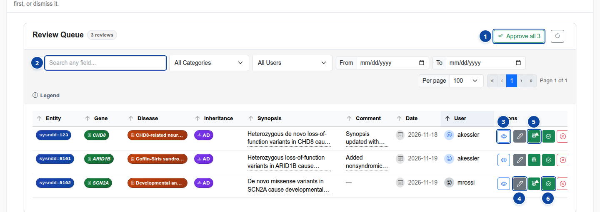
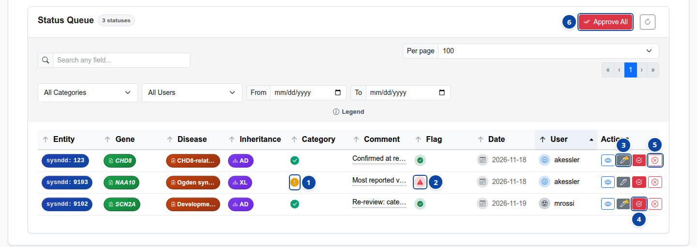

::: {.lead}
Check the reviews and evidence categories that others have submitted, correct them where
needed, and approve them so that they become public.
:::

::: {.callout-note .who-can title="Who can do this"}
Curators and Administrators.
:::

A new or changed review or status becomes public only after a second Curator or
Administrator approves it, unless the submitter used **Direct approval**. Renames,
deactivations and attached GeneReviews chapters take effect at once and do not reach these
queues. Reviews and statuses pass through two queues:

- **Approve review** holds reviews: synopsis, phenotypes, variant types and publications.
- **Approve status** holds statuses: the evidence category and the removal flag.

A review and a status are approved separately. A change submitted through
[Create an entity](curator-create-entity.qmd), [Modify an entity](curator-modify-entity.qmd)
or a re-review usually puts one item in each queue.

Judge each submission against [Curation criteria](05-curation-criteria.qmd). This page
explains the mechanics only.

## Approve a review

::: {.steps}
1. Select **Curation › Approve review** (`/ApproveReview`). The **Approve Reviews** page
   opens with the **Review Queue**.
2. Narrow the list with the search field and the filters [2]{.marker}, if needed.
3. Select the eye icon, **Toggle details** [3]{.marker}, to read the full synopsis and
   the submitter's comment.
4. Check the review against the criteria and the cited publications.
5. Select **Approve review** (check icon) [6]{.marker}.
6. In the **Approve Review** dialog, select **Approve**.
:::

::: {.doc-screenshot}
{#fig-curator-approve-review-table fig-alt="Approve Reviews page with the Review Queue table. Marker 1 points to the Approve all button above the table, marker 2 to the search field, marker 3 to the eye icon of a row, marker 4 to the Edit review pen icon, marker 5 to the stoplight Edit status icon and marker 6 to the Approve review check icon near the end of the row. The Dismiss review icon, a circled cross, sits directly to its right."}
:::

::: {.marker-legend}
1. **Approve all**: approves every pending review; the button shows how many. See the
   warning below.
2. **Search any field**, **All Categories**, **All Users**, **From**, **To**: narrow the
   queue.
3. **Toggle details**: shows the review identifier, ontology, full synopsis and comment.
4. **Edit review**: corrects the review before approval.
5. **Edit status**: opens the status of the same entity. Its color shows the current
   category.
6. **Approve review**: approves the review. **Dismiss review**, the circled cross to its
   right, removes it from the queue.
:::

The approved review becomes the entity's primary review and is shown on the public entity
page. The previous review stays in the database as history.

### Approve a status change at the same time

A small warning triangle on the stoplight button (tooltip **Edit new status**) means that
the submitter also changed the evidence category.

In that case the **Approve Review** dialog shows **Status Change Detected**. Turn on **Also
approve new status** to approve both in one step. Otherwise, approve the status later in
the status queue.

## Correct a review before approving

::: {.steps}
1. Select **Edit review** (pen icon) [4]{.marker}.
2. In the **Edit Review** dialog, correct **Synopsis**, **Phenotypes**, **Variation
   ontology**, **Publications**, **GeneReviews** or **Comment**. The footer shows who
   submitted the review and their role.
3. Select **Save Review**.
:::

The message "The new review for this entity has been submitted successfully." confirms the
save. The corrected review stays in the queue; approve it as a separate step.

If you close the dialog with unsaved changes, SysNDD asks you to **Keep editing** or
**Discard changes**.

## Correct a status

::: {.steps}
1. Select **Edit status** (stoplight icon) [5]{.marker}, in either queue.
2. In the **Edit Status** dialog, select the **Status Category**.
3. Under **Removal Flag**, turn **Suggest removal of this entity** on or off.
4. Add a **Comment** that explains the change.
5. Select **Save Status**.
:::

If the status was still pending, your save updates it. If it was already approved, your
save creates a new pending status, which then appears in the status queue.

## Dismiss a review

Dismiss a review that should not be approved, for example one that repeats an approved
review or rests on the wrong evidence.

::: {.steps}
1. Select **Dismiss review**, the circled cross to the right of **Approve review**
   [6]{.marker}.
2. In the **Dismiss Review** dialog, select **Dismiss**.
:::

The review leaves the queue. As the dialog says, this does not delete the record. The
public review of the entity does not change.

## Handle several pending reviews for one entity

A separate warning button at the end of the row (tooltip "Multiple pending reviews for
this entity"; yellow triangle) appears when two people edited the same entity.

Compare the reviews with **Toggle details** before you decide. When you approve one, the
dialog warns: "Other pending reviews for this entity will be automatically dismissed." If
the other review holds something worth keeping, copy it into the one you approve with
**Edit review** first.

## Approve all pending reviews

::: {.steps}
1. Clear the search and all filters first, so the table shows what you approve. The
   number on the button and in the **Approve All Reviews** dialog counts every pending
   review, whatever the filters show.
2. Select **Approve all** [1]{.marker}.
3. Turn on the switch so that it reads **Yes, I confirm this action**.
4. Select **Approve All**.
:::

::: {.callout-warning title="Approve all ignores your filters"}
**Approve all** approves every pending review in SysNDD, including rows hidden by the
search or filters. Use it only after you have checked the whole queue.
:::

## Approve a status

::: {.steps}
1. Select **Curation › Approve status** (`/ApproveStatus`). The **Approve Statuses** page
   opens with the **Status Queue**.
2. Check the **Category** [2]{.marker} and the **Flag** [3]{.marker} of each row.
3. Select **Toggle details** (eye icon) [4]{.marker} to read the comment.
4. Select **Approve status** [6]{.marker}.
5. In the **Approve Status** dialog, select **Approve**.
:::

::: {.doc-screenshot}
{#fig-curator-approve-status-table fig-alt="Approve Statuses page with the Status Queue table. Marker 1 points to the Approve all button above the table, marker 2 to the Category column, marker 3 to the Flag column, marker 4 to the eye icon of a row, marker 5 to the Edit status icon and marker 6 to the Approve status icon. The Dismiss status icon sits directly to its right."}
:::

::: {.marker-legend}
1. **Approve all**: approves every pending status; clear the filters first.
2. **Category**: the evidence category that was submitted.
3. **Flag**: **No problems**, or **Problematic** when removal was suggested. The icon's
   tooltip then reads "Entity status marked problematic".
4. **Toggle details**: shows the comment.
5. **Edit status**: corrects the status before approval.
6. **Approve status**: approves the status. **Dismiss status**, to its right, removes the
   status from the queue without deleting it.
:::

The approved status sets the evidence category shown on the public pages. A new entity
appears in the public tables when its first status is approved.

The status queue works like the review queue:

- A separate warning button at the end of the row (tooltip "Multiple pending statuses for
  this entity"; yellow triangle) marks several pending statuses. Approving one dismisses the
  others.
- **Edit status (review change pending)** means the same entity also has a review waiting.
  Approve it in the review queue.
- **Approve all** [1]{.marker} opens **Approve All Statuses**, which warns "This action
  cannot be undone." Clear the search and all filters first: the number on the button and
  in the dialog counts every pending status, including rows the filters hide. Turn the
  switch to **Yes, approve all**, then select **Approve All**.

## Decide on a suggested removal

A **Problematic** flag means the submitter suggested withdrawing the entity. Approving the
status records the flag but does not withdraw the entity.

What to do depends on why removal was suggested:

- **The entity is a duplicate or has been superseded.** Deactivate it in
  [Modify an entity](curator-modify-entity.qmd#deactivate-an-entity) and name its
  replacement.
- **The evidence no longer supports the association.** Do not deactivate. Edit the status,
  set the category to **Refuted**, turn the removal flag off, and approve. The entity stays
  visible as Refuted; see [Curation criteria](05-curation-criteria.qmd).
- **You disagree with the suggestion.** Edit the status, turn the removal flag off, and
  approve.

## Common problems

- **An entity's category did not change after you approved the review.** The category
  belongs to the status. Approve the status too, or use **Also approve new status** next
  time.
- **A row is still in the queue after approval.** Select the refresh button at the top of
  the table.
- **You approved too much with Approve all.** There is no undo. Correct each entity in
  [Modify an entity](curator-modify-entity.qmd); your corrections go through the queues
  again.
- **You cannot tell two pending reviews apart.** Open both with **Toggle details** and
  compare the **Review ID** and the synopsis.

## Related pages

- [Curation criteria](05-curation-criteria.qmd): the standard every approval checks
  against.
- [Modify an entity](curator-modify-entity.qmd): where removals and renames happen.
- [Manage re-review](curator-manage-rereview.qmd): approve submitted re-reviews from the
  Reviewers' queue.
- [Data model](04-database-structure.qmd): how reviews, statuses and their history are
  stored.
- [Re-review instructions](06-re-review-instructions.qmd): the review rules the submitted
  reviews follow.

Labels on this page were checked against the SysNDD 0.38.4 app source on November 21,
2026.
