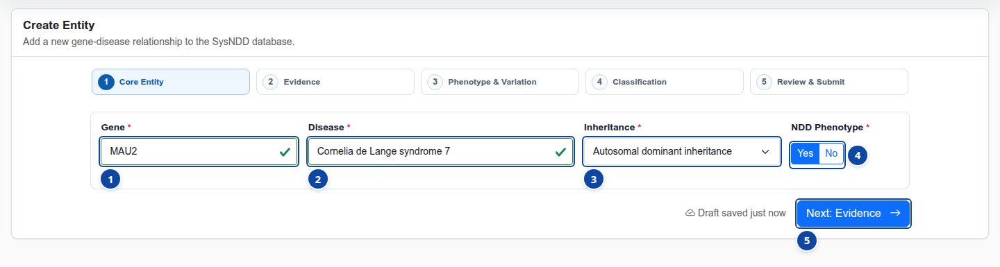
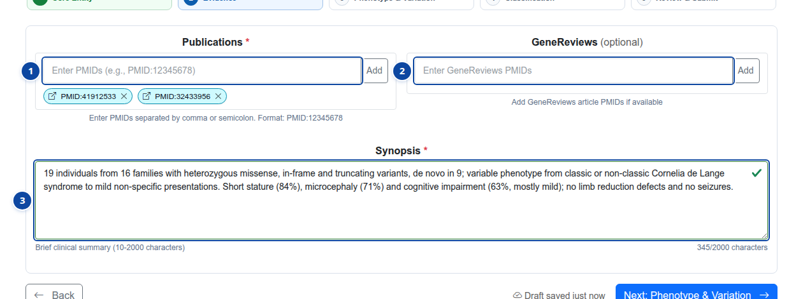
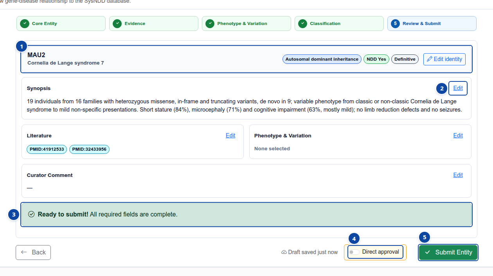

::: {.lead}
Add a new gene-disease association to SysNDD: one gene, one mode of inheritance and one
disease, with the evidence, phenotypes and evidence category that support it.
:::

::: {.callout-note .who-can title="Who can do this"}
Curators and Administrators. The **Curation** menu appears only for these roles.
:::

An entity is the basic record in SysNDD. Its gene, mode of inheritance and disease never
change once it exists. Everything else, the review and the status, can be edited later in
[Modify an entity](curator-modify-entity.qmd).

## Before you start

Check that the entity does not exist yet. Search for the gene as described in
[Find a gene](using-find-gene.qmd). SysNDD refuses a new entity when an active entity
already has the same gene, inheritance, disease and neurodevelopmental disorder (NDD)
phenotype.

Collect the facts you need before you open the form:

- the gene symbol, as approved by the HUGO Gene Nomenclature Committee (HGNC);
- the disease, as an Online Mendelian Inheritance in Man (OMIM) or Mondo Disease Ontology
  (MONDO) entry;
- the mode of inheritance;
- at least one PubMed identifier (PMID) for the publications you used (for a preprint,
  follow rule 1 in [Curation criteria](05-curation-criteria.qmd#ndd-definitive-entities):
  enter its DOI in **Comment** until it has a PMID);
- a draft of the clinical synopsis.

How to find and read the evidence is described in
[Research a gene](curation-research.qmd). Which evidence category the evidence supports is
set out in [Curation criteria](05-curation-criteria.qmd). Decide the category before you
start; the form does not suggest one.

## Open the form

::: {.steps}
1. Sign in.
2. Select **Curation › Create entity** (`/CreateEntity`).
:::

The **Create Entity** page opens at the first of five steps. A progress bar at the top
shows where you are.

| Step | Required fields | Optional fields |
| --- | --- | --- |
| **Core Entity** | Gene, Disease, Inheritance, NDD Phenotype | none |
| **Evidence** | Publications, Synopsis | GeneReviews |
| **Phenotype & Variation** | none | Phenotypes, Variation Ontology |
| **Classification** | Status | Comment |
| **Review & Submit** | checks all steps | Direct approval |

Required fields carry a red asterisk. The **Next** button stays disabled until every
required field of the current step is valid. To go back, select **Back** or select a
completed step in the progress bar.

## Step 1: Name the entity

::: {.steps}
1. In **Gene** [1]{.marker}, type the gene symbol, for example `MAU2`, and select the gene
   from the list. The list shows the HGNC identifier beside each symbol, for example
   `HGNC:29140`.
2. In **Disease** [2]{.marker}, type a disease name or identifier and select the entry,
   for example Cornelia de Lange syndrome 7 (`OMIM:621570`).
3. In **Inheritance** [3]{.marker}, select the mode of inheritance, for example
   **Autosomal dominant inheritance**.
4. Set the **NDD Phenotype** switch [4]{.marker}: on (**Yes**) if the disease is a
   NDD, off (**No**) if it is not.
5. Select **Next: Evidence** [5]{.marker}.
:::

::: {.doc-screenshot}
{#fig-curator-create-entity-core fig-alt="Create Entity page, step 1 of 5. Marker 1 points to the Gene search field showing MAU2, marker 2 to the Disease search field, marker 3 to the Inheritance drop-down, marker 4 to the NDD Phenotype switch and marker 5 to the Next: Evidence button."}
:::

::: {.marker-legend}
1. **Gene**: searches HGNC gene symbols.
2. **Disease**: searches OMIM and MONDO disease names and identifiers.
3. **Inheritance**: the mode of inheritance, as a Human Phenotype Ontology (HPO) term.
4. **NDD Phenotype**: whether the disease is a neurodevelopmental disorder.
5. **Next: Evidence**: moves to step 2 once all four fields are valid.
:::

::: {.callout-warning title="The NDD Phenotype switch needs an answer"}
Before you touch it, the switch reads **No** but no answer is recorded, and **Next** stays
disabled. For an NDD, turn the switch on. For a disease that is not an NDD, turn it on and
off again so that **No** is recorded.
:::

For an entity without an NDD phenotype, select **not applicable** in Step 4. When this is
allowed is set out in
[Special case: non-NDD entities](05-curation-criteria.qmd#special-case-non-ndd-entities).

## Step 2: Add the evidence

::: {.steps}
1. In **Publications** [1]{.marker}, type a PMID in the form `PMID:32433956` and press
   <kbd>Enter</kbd> or select **Add**. Separate several PMIDs with a comma or semicolon.
2. Optional: in **GeneReviews** [2]{.marker}, add the PMID of the GeneReviews chapter for
   this disease, for example `PMID:20301283` (the Cornelia de Lange syndrome chapter, which
   covers *MAU2*). Use the chapter's own PMID, never the general GeneReviews collection
   PMID.
3. In **Synopsis** [3]{.marker}, write the clinical summary. It must be 10 to 2,000
   characters long; the counter below the field shows how many you have used.
4. Select **Next: Phenotype & Variation**.
:::

::: {.doc-screenshot}
{#fig-curator-create-entity-evidence fig-alt="Create Entity page, step 2 of 5. Marker 1 points to the Publications field with two PMID tags, marker 2 to the GeneReviews field and marker 3 to the Synopsis text area with its character counter."}
:::

::: {.marker-legend}
1. **Publications**: PubMed identifiers of the papers you used. Each tag links to PubMed.
2. **GeneReviews**: PubMed identifiers of GeneReviews chapters, if one exists.
3. **Synopsis**: the clinical summary shown on the entity page.
:::

Each PMID becomes a tag that links to PubMed. Open the link to check that you typed the
right number. The form accepts PMIDs of 5 to 8 digits with the `PMID:` prefix.

When you submit, SysNDD checks every PMID against GeneReviews. A GeneReviews chapter typed
into **Publications** is filed as GeneReviews, and a non-GeneReviews PMID typed into
**GeneReviews** is filed as a publication.

What the synopsis should contain, with examples, is described in
[Re-review instructions](06-re-review-instructions.qmd). The same guidance applies to new
entities.

## Step 3: Add phenotypes and variant types

This step is optional. You can also add the terms later.

::: {.steps}
1. In **Phenotypes**, search by term name or HPO identifier (for example `HP:0001249`,
   Intellectual disability) and select the terms that describe the disease. The list is a
   fixed set of SysNDD phenotype terms, not all of HPO.
2. For each term, choose its modifier: present, uncertain, variable, rare or absent.
3. In **Variation Ontology**, select the Variation Ontology (VariO) terms that describe the
   reported variant types, marked present or absent.
4. Select **Next: Classification**.
:::

Which phenotypes to record is set out in
[Re-review instructions](06-re-review-instructions.qmd#phenotypes); the same guidance applies
to new entities.

## Step 4: Set the evidence category

::: {.steps}
1. In **Status**, select the evidence category (**Definitive**, **Moderate**, **Limited**
   or **Refuted**). For an entity whose NDD Phenotype is **No**, select
   **not applicable**; this marks it as outside the NDD scope, not as a lower category.
2. Optional: in **Comment**, add notes for the curator who will check your submission.
3. Select **Next: Review & Submit**.
:::

The app calls the evidence category "Status". The comment is shown to Curators in the
approval queue.

## Step 5: Check and submit

::: {.steps}
1. Read the summary [1]{.marker}: gene, disease, inheritance, NDD phenotype and status.
2. To correct a part, select **Edit identity** or the **Edit** link of a panel
   [2]{.marker}. Your entries are kept.
3. Check that the green message **Ready to submit!** [3]{.marker} is shown.
4. Leave **Direct approval** [4]{.marker} off, unless the section below applies to you.
5. Select **Submit Entity** [5]{.marker}.
:::

::: {.doc-screenshot}
{#fig-curator-create-entity-review fig-alt="Create Entity page, step 5 of 5. Marker 1 points to the entity summary strip, marker 2 to the Edit link of the Synopsis panel, marker 3 to the green Ready to submit message, marker 4 to the Direct approval switch and marker 5 to the Submit Entity button."}
:::

::: {.marker-legend}
1. **Entity summary**: gene, disease, inheritance, NDD phenotype and status.
2. **Edit**: returns to the step that owns the panel.
3. **Ready to submit!**: all required fields are complete.
4. **Direct approval**: approves the entity at once, without a second curator.
5. **Submit Entity**: sends the entity to SysNDD.
:::

The message **Entity submitted successfully** confirms the submission. The form is then
cleared for the next entity.

## What happens after you submit

By default, a new entity waits for a second [Curator]{.role}. Its review appears in **Approve
review** and its status in **Approve status**; see
[Approve reviews and statuses](curator-approve.qmd).

The entity is not public until its status is approved. After approval it appears in the
public tables, on the gene page and in panels.

SysNDD records you as the person who entered the entity, and the approving curator
separately.

### Direct approval

**Direct approval** skips the second curator. The review and the status are approved when
you submit, and the entity becomes public at once.

::: {.callout-warning title="Direct approval publishes immediately"}
The app describes this option as "for experienced curators only". Use it only when your
team has agreed that a single curator may publish this kind of record.
:::

## Recover a draft

The form saves a draft in your browser about two seconds after each change. **Draft saved**
beside the **Next** button shows when it last saved.

When you open **Create entity** again with a draft present, the message **Unsaved draft
found** appears. Select **Restore Draft** to continue, or **Discard** to start empty.

The draft lives only in the browser and on the device where you started it. A draft older
than seven days is discarded. A successful submission deletes the draft.

## Common problems

- **Next stays disabled.** A required field of this step is empty or invalid. On step 1,
  check that you have set the **NDD Phenotype** switch.
- **A PMID does not become a tag.** Type it with the prefix and without spaces, as
  `PMID:12345678`.
- **The submission fails with a conflict.** An active entity with the same gene,
  inheritance, disease and NDD phenotype exists. Open it in
  [Modify an entity](curator-modify-entity.qmd) instead.
- **The submission fails with a publication error.** SysNDD could not retrieve one of the
  PMIDs. Check the numbers and submit again; nothing was saved.
- **The disease is not in the list.** SysNDD offers only diseases from its current OMIM
  and MONDO import. Ask an Administrator whether the disease lists need an update.

## Related pages

- [Curation criteria](05-curation-criteria.qmd): which evidence category the evidence
  supports.
- [Research a gene](curation-research.qmd): how to collect the evidence before you start.
- [Approve reviews and statuses](curator-approve.qmd): the second-curator check that
  publishes your entity.
- [Modify an entity](curator-modify-entity.qmd): edit the entity after it exists.
- [Glossary](reference-glossary.qmd): the terms used on this page.

Labels on this page were checked against the SysNDD 0.38.2 app source on November 20,
2026.
