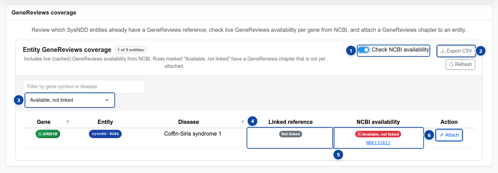
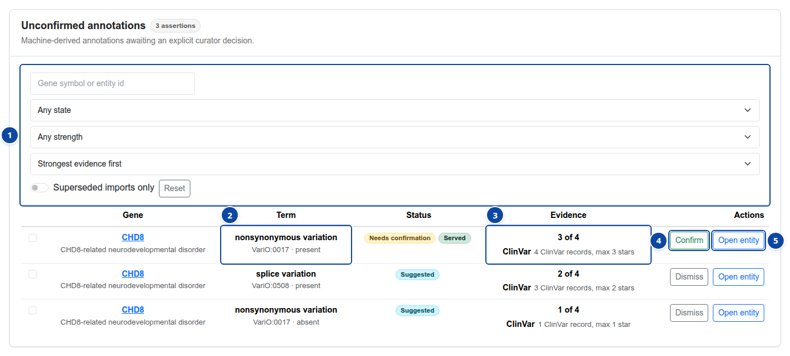

::: {.lead}
Find entities that lack a GeneReviews reference and attach one, and work through variant-type
annotations that were imported automatically and that no curator has confirmed yet.
:::

::: {.callout-note .who-can title="Who can do this"}
Curators and Administrators.
:::

Both tasks are worklists across all entities. They fill gaps in the public entity pages.

## Link GeneReviews chapters

GeneReviews is a collection of expert-written disease chapters on the National Center for
Biotechnology Information (NCBI) Bookshelf. SysNDD links a chapter to an entity's review as
a GeneReviews reference.

### Find entities without a GeneReviews reference

::: {.steps}
1. Select **Curation › GeneReviews coverage** (`/GeneReviews`). The table **Entity
   GeneReviews coverage** lists every active entity.
2. Turn on **Check NCBI availability** [1]{.marker}. SysNDD looks up each gene at NCBI,
   which takes longer than the plain list.
3. In the filter [3]{.marker}, select **Available, not linked**.
:::

::: {.doc-screenshot}
{#fig-curator-genereviews-variation-coverage fig-alt="GeneReviews coverage page. Marker 1 points to the Check NCBI availability switch, marker 2 to the Export CSV button, marker 3 to the link-status filter, marker 4 to the Linked reference column, marker 5 to the NCBI availability column with an Available, not linked badge and marker 6 to the Attach button of that row."}
:::

::: {.marker-legend}
1. **Check NCBI availability**: adds the live check for a chapter per gene.
2. **Export CSV**: downloads the table as a spreadsheet file.
3. Link-status filter: **All entities**, **Already linked**, **Not linked** or
   **Available, not linked**.
4. **Linked reference**: **Linked**, with the Bookshelf accession, or **Not linked**.
5. **NCBI availability**: whether NCBI has a chapter for the gene.
6. **Attach**: links a chapter to this entity.
:::

The **NCBI availability** column shows one of these values:

| Value | Meaning |
| --- | --- |
| **Available** | a chapter exists and is linked |
| **Available, not linked** | a chapter exists but this entity does not cite it |
| **None found** | NCBI has no chapter for the gene |
| **Lookup failed** | NCBI did not answer; select **Refresh** later |
| **Not checked** | **Check NCBI availability** is turned off |

### Attach a chapter

::: {.steps}
1. In the row, open the chapter link (a Bookshelf accession that starts with `NBK`) and check that the
   chapter covers this entity's disease.
2. Note the chapter's PubMed identifier (PMID). Use the chapter's own PMID, never the
   general GeneReviews collection PMID; see
   [Re-review instructions](06-re-review-instructions.qmd#find-the-pmid-of-a-genereviews-chapter).
3. Select **Attach**.
4. In the **Attach GeneReviews reference** dialog, type the **GeneReviews chapter PMID**,
   for example `20301283`, the Cornelia de Lange syndrome chapter that covers *MAU2*.
5. Select **Attach**.
:::

The message **GeneReviews reference attached** confirms the link.

::: {.callout-warning title="Attaching publishes at once"}
The chapter is added to the entity's current public review. It does not pass through the
approval queues. Check the chapter before you attach it.
:::

NCBI availability is checked per gene, but you attach per entity. A gene with several
entities may have a chapter that covers only some of its diseases. Attach the chapter only
to the entities it describes.

SysNDD rejects a PMID that is not a GeneReviews chapter. Attaching a chapter that is
already linked changes nothing.

### Export the coverage table

Select **Export CSV** to download the table as comma-separated values. With **Check NCBI
availability** on, the file includes the availability column.

## Review variation suggestions

Variation Ontology (VariO) terms describe the types of variant reported for an entity, for
example protein truncation. Some terms were imported from external databases, such as
ClinVar, instead of being entered by a curator.

On the public entity page, an imported term carries the note "Not yet confirmed by a
curator". After a curator confirms it, the note reads "Confirmed by a curator". This queue
collects all unconfirmed terms across SysNDD.

### Work through the queue

::: {.steps}
1. Select **Curation › Variation suggestions** (`/curate/variation-suggestions`). The
   table **Unconfirmed annotations** opens.
2. Narrow the list [1]{.marker}: type a gene symbol or entity identifier and press
   <kbd>Enter</kbd>, choose a state and an evidence strength, and choose the sort order.
3. For each row, read the term [2]{.marker} and its evidence [3]{.marker}.
4. Select **Confirm** or **Dismiss** [4]{.marker}, whichever the row offers.
:::

::: {.doc-screenshot}
{#fig-curator-genereviews-variation-suggestions fig-alt="Variation suggestions page with the Unconfirmed annotations table. Marker 1 points to the filter row with search, state, strength and sort controls; marker 2 to the Term column of a row; marker 3 to its Evidence column with a strength score and source names; marker 4 to the Confirm button; marker 5 to the Open entity button."}
:::

::: {.marker-legend}
1. Filters: **Gene symbol or entity id**, state, evidence strength, sort order,
   **Superseded imports only** and **Reset**.
2. **Term**: the VariO term, its identifier and its modifier.
3. **Evidence**: the strength score and each source with its own summary.
4. **Confirm** or **Dismiss**: the one action this row allows.
5. **Open entity**: opens the public entity page.
:::

Every row has one of two states:

| State | On the public page? | Action | What the action does |
| --- | --- | --- | --- |
| **Needs confirmation** | yes, badge **Served** | **Confirm** | records that you read the evidence and agree |
| **Suggested** | no | **Dismiss** | rejects the candidate term |

**Confirm** keeps the term on the entity and changes its public note to "Confirmed by a
curator". **Dismiss** rejects a candidate that was never public.

The **Evidence** column shows a strength score from **0 of 4** to **4 of 4**, or **Not
recorded**. Sorting by **Strongest evidence first** puts the clearest cases at the top.

A **Moved** badge means "A curator review has since replaced the import that wrote this
evidence". Turn on **Superseded imports only** to see these rows alone.

### Confirm or dismiss several rows

Tick the rows, then select **Confirm selected** or **Dismiss selected**. The rows must all
need the same action. If they do not, the page says "Selected rows need different actions —
select one kind at a time."

The result message reports how many rows were applied and why any were skipped, for example
"10 of 12 applied". A row can be skipped when another curator changed it in the meantime.

### Add or remove a term

This queue cannot add a suggested term or remove a served one. Those are changes to the
review:

::: {.steps}
1. Open the entity in **Curation › Modify entity**.
2. Select **Modify review** or **Status & Review**.
3. In **Variation ontology**, select **Accept** on a suggested term, or **Remove** on a term
   that needs confirmation.
4. Submit. The change goes through review approval.
:::

See [Modify an entity](curator-modify-entity.qmd) for the full form.

## Common problems

- **A linked row also shows Available, not linked.** **Check NCBI availability** is off,
  so the column has no NCBI result. Turn the check on.
- **Attach fails with "PMID does not correspond to a GeneReviews chapter."** You typed the
  PMID of an ordinary article. Use the PMID shown on the GeneReviews chapter page.
- **Attach fails with "No review found for this entity."** The entity has no review yet.
  Add one in [Modify an entity](curator-modify-entity.qmd).
- **A row offers neither Confirm nor Dismiss.** The term must be added or removed on the
  entity itself; select **Open entity** and edit the review.
- **Some selected rows were skipped.** Their state changed since the page loaded. The
  result message names the reason; reload and decide again.

## Related pages

- [Modify an entity](curator-modify-entity.qmd): add or remove terms in the review.
- [Approve reviews and statuses](curator-approve.qmd): where review changes are approved.
- [Research a gene](curation-research.qmd): find the GeneReviews chapter and other sources.
- [Data model](04-database-structure.qmd): how variant types and references are stored.
- [Deployment](09-deployment.qmd): implementation notes on variation-ontology provenance.

Labels on this page were checked against the SysNDD 0.38.4 app source on November 21,
2026.
