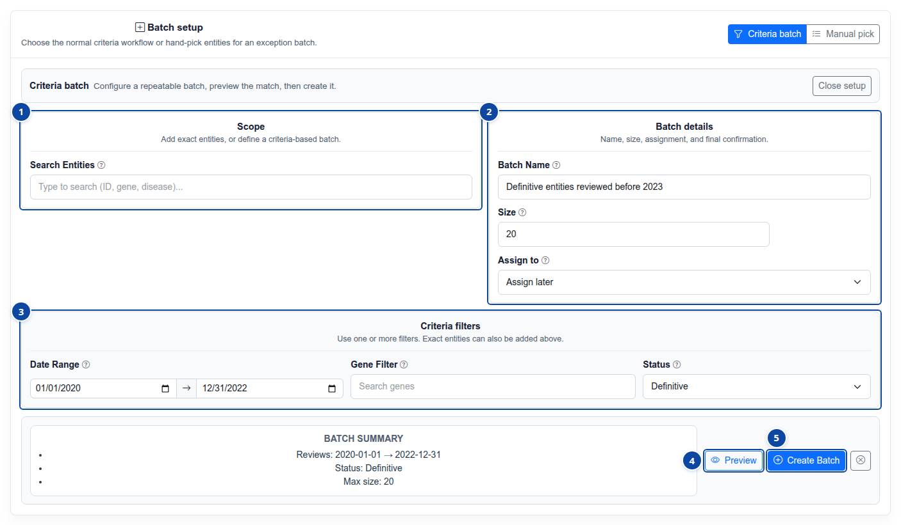
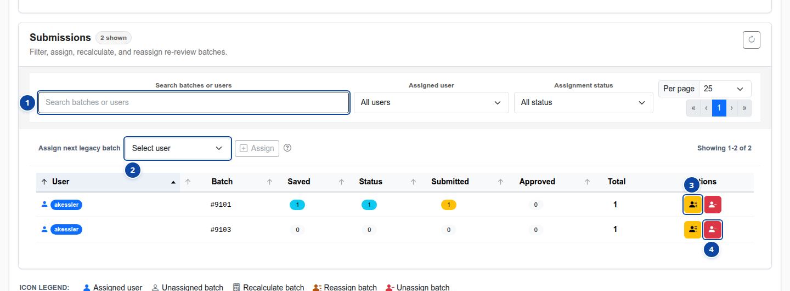
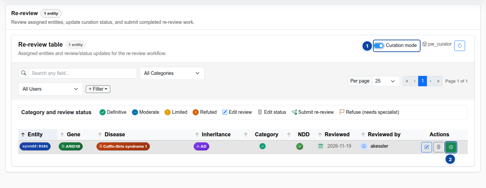
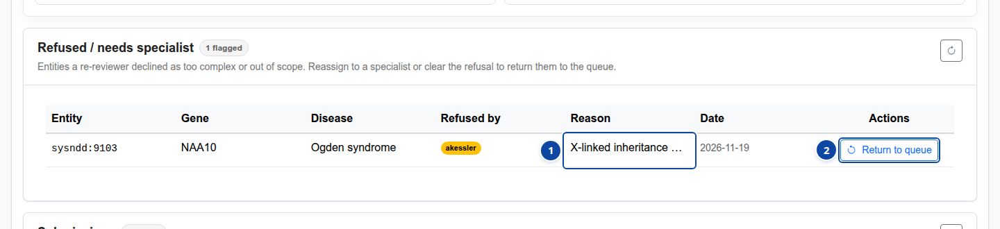

::: {.lead}
Group existing entities into batches, assign them to Reviewers, follow their progress and
approve the work they submit.
:::

::: {.callout-note .who-can title="Who can do this"}
Curators and Administrators. The Reviewers who do the re-review work are described in
[Re-review instructions](06-re-review-instructions.qmd).
:::

Re-review is the systematic reassessment of existing entities. A Curator prepares the work
in batches; a Reviewer works through an assigned batch and submits each entity; a Curator
approves the result. The cycle has five tasks:

1. [Create a batch](#create-a-batch-from-criteria) of entities to reassess.
2. [Assign the batch](#assign-reassign-and-unassign-batches) to a Reviewer.
3. The Reviewer edits and submits each entity.
4. [Approve the submitted work](#approve-submitted-re-reviews).
5. [Handle entities the Reviewer refused](#handle-refused-entities).

## Open the page

Select **Curation › Manage re-review** (`/ManageReReview`). The **Manage Re-review** page
shows four counts at the top: **Batches**, **Assigned**, **Unassigned** and **Available
entities**.

Below them, **Batch setup** offers two ways to build a batch:

- **Criteria batch**: the normal way. Select entities by date, gene and evidence category,
  or add exact entities under **Scope**.
- **Manual pick**: for exceptions. Choose exact entities by hand.

## Create a batch from criteria

::: {.steps}
1. Under **Batch setup**, select **Criteria batch**. The form opens; **Close setup** hides
   it again.
2. Optional: under **Scope** [1]{.marker}, use **Search Entities** to add exact entities by
   identifier, gene or disease.
3. Under **Batch details** [2]{.marker}, optionally type a **Batch Name**. If you leave it
   empty, SysNDD generates a name from the criteria.
4. Set **Size**, the maximum number of entities in the batch, from 1 to 100. The default
   is 20.
5. In **Assign to**, select a Reviewer, or keep **Assign later**.
6. Under **Criteria filters** [3]{.marker}, set at least one of **Date Range** (last review
   date, both dates), **Gene Filter** or **Status**, unless you added entities in step 2.
7. Select **Preview** [4]{.marker} to see the matching entities.
8. Select **Create Batch** [5]{.marker}.
:::

::: {.doc-screenshot}
{#fig-curator-manage-rereview-criteria fig-alt="Batch setup section of the Manage Re-review page with Criteria batch selected. Marker 1 points to the Scope panel with the Search Entities field, marker 2 to the Batch details panel with Batch Name, Size and Assign to, marker 3 to the Criteria filters with date range, gene filter and status, marker 4 to the Preview button and marker 5 to the Create Batch button."}
:::

::: {.marker-legend}
1. **Scope**: **Search Entities** adds exact entities to the batch.
2. **Batch details**: **Batch Name** (optional; generated if empty), **Size** (1 to 100) and
   **Assign to** (a Reviewer now, or **Assign later**).
3. **Criteria filters**: **Date Range**, **Gene Filter** and **Status**.
4. **Preview**: lists the entities that match, without creating anything.
5. **Create Batch**: creates the batch.
:::

The message "Batch created and table refreshed" confirms the new batch. It appears in the
**Submissions** table below.

**Date Range** needs both a start and an end date. **Gene Filter** adds all entities of the
selected genes. **Status** limits the batch to one evidence category; **Any status**
applies no limit.

::: {.callout-note title="Batches keep a gene together"}
A batch never splits the entities of one gene. If the last gene would cross the size limit,
the batch grows past it, and the preview says so. Narrow the criteria or raise the size if
that is not what you want.
:::

## Create a batch by hand

Use **Manual pick** only for exceptions, such as a set of entities a specialist should
check.

::: {.steps}
1. Under **Batch setup**, select **Manual pick**.
2. In **Assign to**, select the user.
3. Optional: type a **Batch name**; otherwise it is generated.
4. Under **Entities**, search the available entities and tick each one you want. The table
   shows **ID**, **Gene**, **Disease**, **Last Review** and **Status**.
5. Select **Assign *n* selected**, where *n* is the number of ticked entities.
:::

**Clear** removes your selection. **Refresh entities** reloads the list of entities that
are available for re-review.

## Assign, reassign and unassign batches

The **Submissions** table lists every batch with its progress.

| Column | Shows |
| --- | --- |
| **User** | the assigned user, or none |
| **Batch** | the batch number |
| **Saved**, **Status** | entities whose review or status the user has saved |
| **Submitted**, **Approved** | entities submitted by the user, and approved by a curator |
| **Total** | entities in the batch |

::: {.doc-screenshot}
{#fig-curator-manage-rereview-submissions fig-alt="Submissions table on the Manage Re-review page. Marker 1 points to the search and filter fields, marker 2 to the Assign next legacy batch controls, marker 3 to the calculator icon on an unassigned batch, marker 4 to the reassign icon on an assigned batch and marker 5 to the unassign icon on the same row."}
:::

::: {.marker-legend}
1. **Search batches or users**, **Assigned user**, **Assignment status**: filter the
   table.
2. **Assign next legacy batch**: gives the lowest-numbered unassigned batch to the
   selected user.
3. **Recalculate batch contents**: rebuilds an unassigned batch from new criteria.
4. **Reassign to different user**: moves an assigned batch to another user.
5. **Unassign this batch**: takes the batch away from its user.
:::

### Assign an existing batch

Batches created with **Assign later**, and older pre-computed batches, wait unassigned.
Select a user under **Assign next legacy batch** and select **Assign**. This gives the user
the lowest-numbered unassigned batch, whether pre-computed or created with **Assign later**,
and emails them. The message "New batch assigned successfully." confirms it. **Assign**
stays disabled until you select a user, and it works only when the **Unassigned** count is
above zero.

To give a specific batch to someone, create it with that user under **Assign to**.

### Reassign a batch

::: {.steps}
1. In the row of an assigned batch, select **Reassign to different user**.
2. In the **Reassign Batch** dialog, choose the user under **Select new user:**.
3. Select **Reassign**.
:::

### Unassign or recalculate a batch

Select **Unassign this batch** to return a batch to the unassigned pool. The message "Batch
unassigned successfully." confirms it.

Only an unassigned batch can be recalculated. Select **Recalculate batch contents**, set
**Review Date Range**, **Status Category** and **Batch Size** in the **Recalculate Batch
Contents** dialog, and select **Recalculate**.

The user lists on this page offer accounts with the Reviewer or Curator role.

## Approve submitted re-reviews

A Reviewer's submitted entity waits for a [Curator]{.role}. You approve it from the Reviewers' own
page.

::: {.steps}
1. Select **Review › Re-Review** (`/Review`).
2. Turn on **Curation mode** [1]{.marker}. The table now lists submitted entities from all
   Reviewers.
3. Check the entity's review and status.
4. Select **Approve entity review/status** (check icon) at the end of the row
   [2]{.marker}.
5. In the **Approve Entity** dialog, under **Select Items to Approve**, turn on **Review**,
   **Status** or both.
6. Select **Approve**.
:::

::: {.doc-screenshot}
{#fig-curator-manage-rereview-curation-mode fig-alt="Re-review table on the Re-Review page. Marker 1 points to the Curation mode switch, which is on; marker 2 points to the approve button at the end of a submitted row."}
:::

::: {.marker-legend}
1. **Curation mode**: shows submitted entities for approval. Only Curators and
   Administrators see this switch.
2. **Approve entity review/status**: opens the approval dialog.
:::

If the work needs changes, select **Unsubmit Review** in the same dialog instead. It
returns the entity to the Reviewer for further changes.

The **Approved** count of the batch goes up in the **Submissions** table.

## Handle refused entities

A Reviewer can refuse an entity that is too complex or outside their expertise. Refused
entities are neither approved nor rejected; they wait in the **Refused / needs
specialist** panel at the bottom of the page.

The panel lists each entity with the Reviewer's reason, who refused it and when.

::: {.doc-screenshot}
{#fig-curator-manage-rereview-refused fig-alt="Refused / needs specialist panel. Marker 1 points to the reason column of a refused entity and marker 2 to its Return to queue button."}
:::

::: {.marker-legend}
1. **Reason**: the Reviewer's explanation, if given.
2. **Return to queue**: clears the refusal so the entity re-enters normal re-review.
:::

A refused entity stays in its assigned batch. You have two options:

- To send it back as it is, select **Return to queue** [2]{.marker}.
- To have a specialist check it, move the whole batch to that person with **Reassign to
  different user** in the **Submissions** table; see [Reassign a batch](#reassign-a-batch).
  SysNDD cannot move a single entity out of an assigned batch, and a refused entity does not
  appear under **Manual pick**.

Clearing a refusal changes no review and no status.

## Common problems

- **Preview and Create Batch are disabled.** No criterion is set. Add at least one: entities under
  **Search Entities**, both dates in **Date Range**, a gene in **Gene Filter**, or a
  **Status**. The form shows the hint "Select entities, set date range, or choose a
  gene/status filter".
- **The batch holds more entities than the size you set.** A gene's entities are kept
  together; see the note above.
- **A Reviewer is missing from Assign to.** The account is not approved yet or has the
  Viewer or Administrator role. Only Reviewer and Curator accounts are offered. See [Approve user accounts](curator-users.qmd).
- **Recalculate is not offered.** The batch is assigned. Unassign it first.
- **Curation mode is not shown.** Your account does not have the Curator or Administrator
  role.

## Related pages

- [Re-review instructions](06-re-review-instructions.qmd): what Reviewers do with an
  assigned batch.
- [Approve reviews and statuses](curator-approve.qmd): the general approval queues.
- [Approve user accounts](curator-users.qmd): give a new Reviewer access.
- [Curation criteria](05-curation-criteria.qmd): the standard re-review applies.

Labels on this page were checked against the SysNDD 0.38.2 app source on November 20,
2026.
