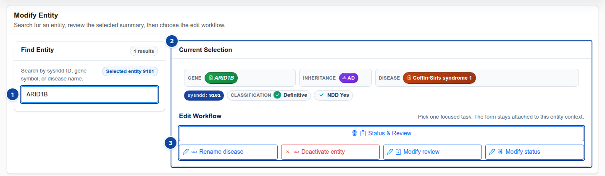
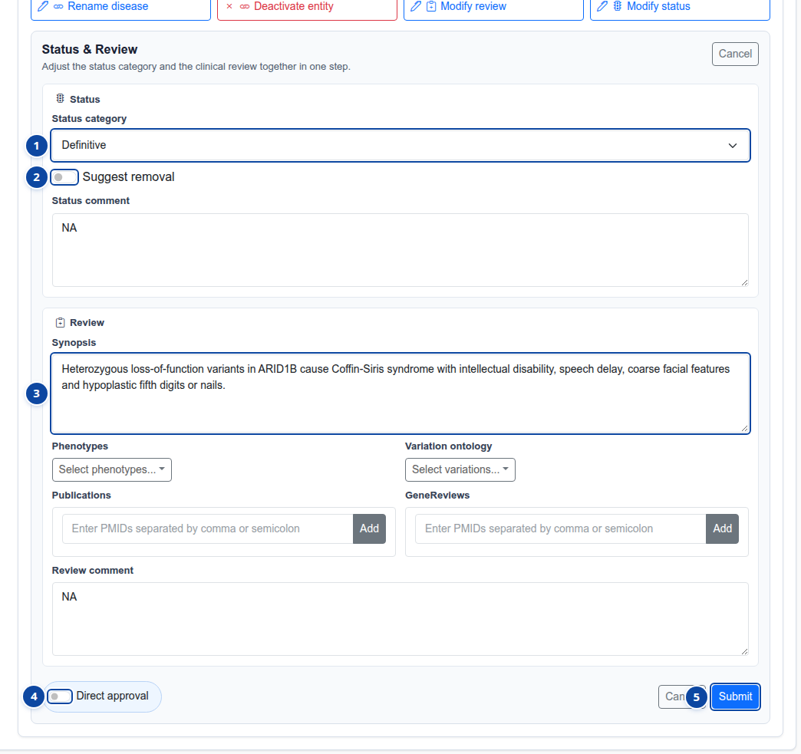
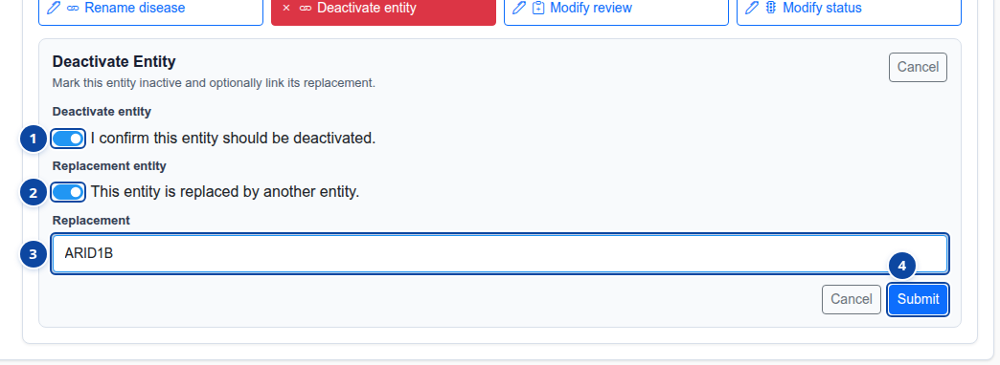

::: {.lead}
Update the review or evidence category of an existing entity, rename its disease,
withdraw a duplicate entity, or reactivate one withdrawn by mistake.
:::

::: {.callout-note .who-can title="Who can do this"}
Curators and Administrators.
:::

An entity's gene, mode of inheritance and disease are fixed. Renaming the disease therefore
creates a new entity (see below). What you can change depends on
which part you want to correct:

- To change the synopsis, phenotypes, variant types or publications, edit the **review**.
- To change the evidence category, edit the **status**.
- To replace the disease with a better or newer disease entry, **rename** the disease.
- To change the gene or the mode of inheritance, create a new entity in
  [Create an entity](curator-create-entity.qmd). Then **deactivate** the old one and name
  the new one as its replacement.

## Find the entity

::: {.steps}
1. Select **Curation › Modify entity** (`/ModifyEntity`).
2. In **Find Entity** [1]{.marker}, type an entity identifier, a gene symbol or a disease
   name.
3. Select the entity from the list.
:::

The **Current Selection** panel [2]{.marker} shows the entity's gene, disease,
inheritance, evidence category and neurodevelopmental disorder (NDD) phenotype. Check that
you have the right entity before you edit.

Below it, **Edit Workflow** offers five buttons [3]{.marker}. Choose one; its form opens
under the buttons.

::: {.doc-screenshot}
{#fig-curator-modify-entity-selected fig-alt="Modify Entity page. Marker 1 points to the Find Entity search field on the left, marker 2 to the Current Selection summary of the chosen entity and marker 3 to the row of Edit Workflow buttons: Status & Review, Rename disease, Deactivate entity, Modify review and Modify status."}
:::

::: {.marker-legend}
1. **Find Entity**: search by entity identifier, gene or disease.
2. **Current Selection**: the entity you are about to change.
3. **Edit Workflow**: the five tasks described on this page.
:::

| Button | Use it to | Takes effect |
| --- | --- | --- |
| **Status & Review** | change the category and the review together | after approval, or at once with **Direct approval** |
| **Modify review** | edit the review only | after approval |
| **Modify status** | change the category or suggest removal | after approval |
| **Rename disease** | replace the disease | at once; creates a new entity |
| **Deactivate entity** | withdraw a duplicate or superseded entity | at once |

## Change the review and status together

Use **Status & Review** when new evidence changes the category and the synopsis at the
same time, which is the usual case.

::: {.steps}
1. Select **Status & Review**.
2. Under **Status** [1]{.marker}, select the new **Status category** if it changes.
3. Optional: turn on **Suggest removal** [2]{.marker} and explain why in **Status
   comment**.
4. Under **Review** [3]{.marker}, edit **Synopsis**, **Phenotypes**, **Variation
   ontology**, **Publications** and **GeneReviews** as needed.
5. Optional: add a **Review comment** for the approving curator.
6. Leave **Direct approval** [4]{.marker} off unless your team allows single-curator
   approval.
7. Select **Submit** [5]{.marker}. With **Direct approval** on, the button reads
   **Submit & approve**.
:::

::: {.doc-screenshot}
{#fig-curator-modify-entity-combined fig-alt="Status & Review form below the selected entity. Marker 1 points to the Status category drop-down, marker 2 to the Suggest removal switch, marker 3 to the Review fieldset with the synopsis text area, marker 4 to the Direct approval switch and marker 5 to the Submit button."}
:::

::: {.marker-legend}
1. **Status category**: the evidence category.
2. **Suggest removal**: flags the entity for withdrawal; a [Curator]{.role} decides later.
3. **Review**: synopsis, phenotypes, variant types and publications.
4. **Direct approval**: approves both changes at once.
5. **Submit**: sends the changes.
:::

The message **Status & review submitted successfully** confirms the submission, or
**Status & review submitted and approved** with direct approval.

If you changed nothing and **Direct approval** is off, the form closes without submitting.
With **Direct approval** on, it approves the current review and status as they are.

### Variant types with machine-derived terms

Some Variation Ontology (VariO) terms were imported from external databases rather than
entered by a curator. In **Variation ontology**, such terms are grouped by state:

- **Confirmed**: a curator has agreed with the term.
- **Needs confirmation**: shown publicly but not yet checked. Select **Confirm** to record
  that you agree, or **Remove** to take the term off the entity.
- **Suggested — not in the entity**: a candidate term. Select **Accept** to add it, or
  **Dismiss** to reject it.

Saving the review leaves an unconfirmed term in place. Only **Confirm** records your
agreement. The same terms appear across all entities in
[Variation suggestions](curator-genereviews-variation.qmd#review-variation-suggestions).

## Edit only the review or only the status

**Modify review** opens the review fields alone: **Synopsis**, **Phenotypes**,
**Variation ontology**, **Publications**, **GeneReviews** and **Comment**.

**Modify status** opens the status fields alone: **Status**, **Suggest removal** and
**Comment**.

Select **Submit** to send. The current review or status stays public until a
[Curator]{.role} approves your change in [Approve reviews and statuses](curator-approve.qmd). These two
buttons offer no direct approval.

## Rename the disease

Rename when the disease entry itself should change, for example when Online Mendelian
Inheritance in Man (OMIM) splits a phenotype, or a more specific Mondo Disease Ontology
(MONDO) entry exists.

::: {.steps}
1. Select **Rename disease**.
2. In **New disease**, search by disease name or ontology identifier.
3. Select the new disease from the list.
4. Select **Submit**.
:::

The message "The new disease name for this entity has been submitted" confirms the change.

A rename takes effect at once, without approval. SysNDD creates a new entity with the new
disease and a new entity identifier. It copies the review, the status and their approval
state to the new entity. The old entity is deactivated and points to the new one.

::: {.callout-warning title="A rename changes the entity identifier"}
Links that use the old identifier now lead to a page-not-found message. Tell anyone who
cites the entity, such as a co-author or a diagnostic lab, the new identifier.
:::

SysNDD refuses the rename if an active entity with the same gene, inheritance, NDD
phenotype and new disease already exists. In that case, deactivate this entity and name the
existing one as its replacement.

## Deactivate an entity

SysNDD never deletes entities. A duplicate or superseded entity is deactivated: it
disappears from the public tables and pages, and the record stays in the database.

Deactivate only duplicates and superseded entities. An association that no longer meets
the criteria is not deactivated: set its status to **Refuted** so that it stays visible;
see [Curation criteria](05-curation-criteria.qmd).

::: {.steps}
1. Select **Deactivate entity**.
2. Turn on **I confirm this entity should be deactivated.** [1]{.marker}
3. The switch **This entity is replaced by another entity.** [2]{.marker} now appears.
   Turn it on if another entity replaces this one.
4. In the **Replacement** field [3]{.marker} that appears, search by identifier, gene symbol or disease name, and
   select the replacing entity.
5. Select **Submit** [4]{.marker}.
:::

::: {.doc-screenshot}
{#fig-curator-modify-entity-deactivate fig-alt="Deactivate Entity form. Marker 1 points to the confirmation switch, marker 2 to the replacement switch, marker 3 to the Replacement search field with an entity selected and marker 4 to the Submit button."}
:::

::: {.marker-legend}
1. **Deactivate entity**: confirms that the entity should be withdrawn.
2. **Replacement entity**: states that another entity supersedes this one.
3. **Replacement**: the entity that takes its place.
4. **Submit**: deactivates the entity at once.
:::

The message "The deactivation for this entity has been submitted" confirms the change.

::: {.callout-warning title="Deactivation is immediate"}
The entity leaves the public views as soon as you submit, and links to it lead to a
page-not-found message. There is no approval step. Only an Administrator can reverse a
deactivation; see [Reactivate an entity](#reactivate-an-entity).
:::

If you are not sure that an entity should go, use **Modify status** with **Suggest
removal** instead. The flag reaches the status approval queue, where another curator can
decide.

## Reactivate an entity

::: {.callout-note .who-can title="Who can do this"}
Administrators only. Curators do not see this panel.
:::

Reactivation undoes a deactivation made by mistake. The entity becomes active again with
its existing reviews and statuses, and its link to a replacement entity is cleared.
Deactivated entities do not appear in the entity search, so you need the entity's SysNDD
identifier.

::: {.steps}
1. Open **Curation › Modify entity** (`/ModifyEntity`).
2. Under **Reactivate a deactivated entity**, type the number of the entity in
   **Entity ID (sysndd:)**, for example `123` for `sysndd:123`.
3. Select **Reactivate entity**.
4. Check the entity identifier in the **Reactivate entity?** window and select
   **Reactivate**.
:::

The message "Entity sysndd:123 has been reactivated." confirms the change. The entity
appears in the public views again if it has an approved status.

SysNDD refuses the reactivation when another active entity already covers the same
gene-disease association. This is the entity's replacement, or an entity with the same
gene, mode of inheritance and disease. The message names that entity. To make the old
entity current again, deactivate the covering entity first, then reactivate.

## Common problems

- **The Edit Workflow buttons are greyed out.** Another submission is still running. Wait
  for the message, then continue.
- **Your review change does not appear on the entity page.** It is waiting for approval in
  [Approve reviews and statuses](curator-approve.qmd).
- **Rename fails with a conflict.** The destination entity already exists: deactivate this
  entity with that one as the replacement. Or the entity has no approved status yet:
  approve its status first.
- **You need to change the gene or the inheritance.** Create a new entity, then deactivate
  this one with the new entity as its replacement.
- **Reactivation fails with "Entity is already active."** The entity was never deactivated,
  or someone reactivated it a moment ago. Open it in the entity search to check.

## Related pages

- [Approve reviews and statuses](curator-approve.qmd): where review and status changes are
  approved.
- [Create an entity](curator-create-entity.qmd): for a new gene, inheritance or disease
  combination.
- [Curation criteria](05-curation-criteria.qmd): which evidence category to choose.
- [Data model](04-database-structure.qmd): how entities, reviews and statuses relate.
- [Glossary](reference-glossary.qmd): entity, review, status and deactivate defined.

Labels on this page were checked against the SysNDD 0.38.2 app source on November 20,
2026.
