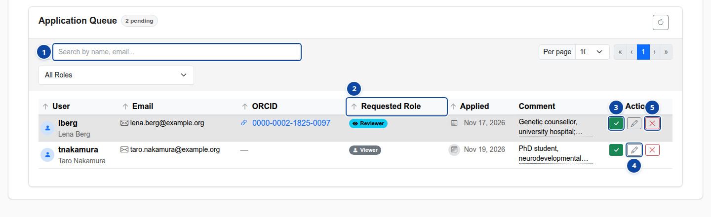
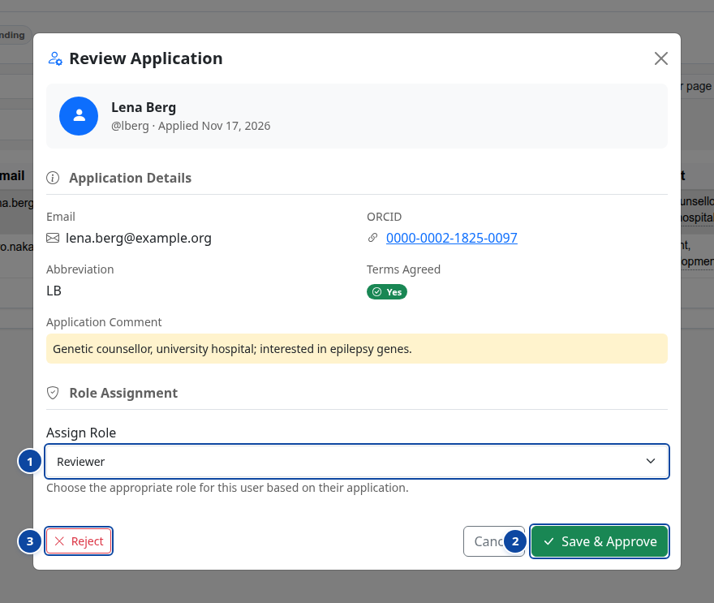

::: {.lead}
Check applications for a SysNDD account, give each applicant the right role, and approve or
reject the application.
:::

::: {.callout-note .who-can title="Who can do this"}
Curators and Administrators. A Curator can give the Viewer, Reviewer or Curator role; only
an Administrator can give the Administrator role.
:::

People apply for an account on the registration page, described in
[Your account](using-account.qmd). An application stays pending until a Curator or
Administrator approves it. Nobody can sign in with a pending account.

## Choose the role

The role decides what the person can do after signing in.

| Role | Can do |
| --- | --- |
| [Viewer]{.role} | sign in; no curation or review pages (read-only) |
| [Reviewer]{.role} | re-review assigned entities ([Re-review instructions](06-re-review-instructions.qmd)) |
| [Curator]{.role} | everything a Reviewer can, plus the **Curation** menu |
| [Administrator]{.role} | everything a Curator can, plus the **Administration** menu |

A new application starts with the Viewer role. Give a higher role only when the applicant's
work for SysNDD needs it, for example Reviewer for a re-review volunteer.

## Assess an application

::: {.steps}
1. Select **Curation › Approve user** (`/ApproveUser`). The **Approve Users** page opens
   with the **Application Queue**.
2. Find the applicant with **Search by name, email...** or the **All Roles** filter
   [1]{.marker}.
3. Select **Edit & review** [4]{.marker} (pencil icon) to open the application.
:::

::: {.doc-screenshot}
{#fig-curator-users-table fig-alt="Approve Users page with the Application Queue table. Marker 1 points to the search field and role filter, marker 2 to the Requested Role column, marker 3 to the green Approve user button of a row, marker 4 to the Edit and review pencil button and marker 5 to the Reject application button."}
:::

::: {.marker-legend}
1. **Search by name, email...** and **All Roles**: find an application.
2. **Requested Role**: the role stored with the application.
3. **Approve user**: approves with the role shown.
4. **Edit & review**: opens the full application and the role choice.
5. **Reject application**: deletes the application.
:::

In the **Review Application** dialog, check under **Application Details**:

- **Email**: an institutional address supports the applicant's identity.
- **ORCID**: the link opens the applicant's ORCID record (Open Researcher and Contributor
  ID). Check that name and affiliation match.
- **Application Comment**: the research interest the applicant gave.
- **Terms Agreed**: should read **Yes**.

**Abbreviation** is set automatically to the person's initials when you approve the account.

## Approve an application

::: {.steps}
1. In the **Review Application** dialog, under **Role Assignment**, choose the role in
   **Assign Role** [1]{.marker}.
2. Select **Save & Approve** [2]{.marker}.
:::

::: {.doc-screenshot}
{#fig-curator-users-modal fig-alt="Review Application dialog showing the applicant's email, ORCID, abbreviation, terms agreed and comment. Marker 1 points to the Assign Role drop-down, marker 2 to the Save & Approve button and marker 3 to the Reject button at the bottom left."}
:::

::: {.marker-legend}
1. **Assign Role**: the role the person receives.
2. **Save & Approve**: saves the role and approves the account.
3. **Reject**: rejects the application instead.
:::

The message "User approved successfully." confirms the approval.

SysNDD then activates the account and emails the applicant a temporary password with a
link to the login page.

For an application that needs no role change, select **Approve user** (check mark) in the
table. The **Approve User** dialog names the role the person will receive. Select
**Approve**.

## Reject an application

::: {.steps}
1. Select **Reject application** (cross) in the table, or **Reject** in the **Review
   Application** dialog.
2. In the **Reject Application** dialog, select **Reject Application**.
:::

::: {.callout-warning title="Rejection deletes the application"}
As the dialog says, rejection deletes the application and cannot be undone. The person can
register again later.
:::

## Change the role of an existing account

This page handles new applications only. An Administrator changes the role of an existing
account under **Administration › Manage user**.

## Common problems

- **Administrator is not offered in Assign Role.** Only Administrators can give that role.
  Ask an Administrator.
- **Approval fails with "User account already active."** Another [Curator]{.role} approved
  the application first. Select the refresh button to update the queue.
- **The applicant did not receive the email.** Ask them to check their spam folder, then
  to set a new password with the password reset described in
  [Your account](using-account.qmd).
- **The queue shows "No pending user applications".** There is nothing to approve.

## Related pages

- [Your account](using-account.qmd): how people register and sign in.
- [Manage re-review](curator-manage-rereview.qmd): assign work to a new Reviewer.
- [Re-review instructions](06-re-review-instructions.qmd): what a Reviewer does.
- [Glossary](reference-glossary.qmd): the role names defined.

Labels on this page were checked against the SysNDD 0.38.4 app source on November 21,
2026.
