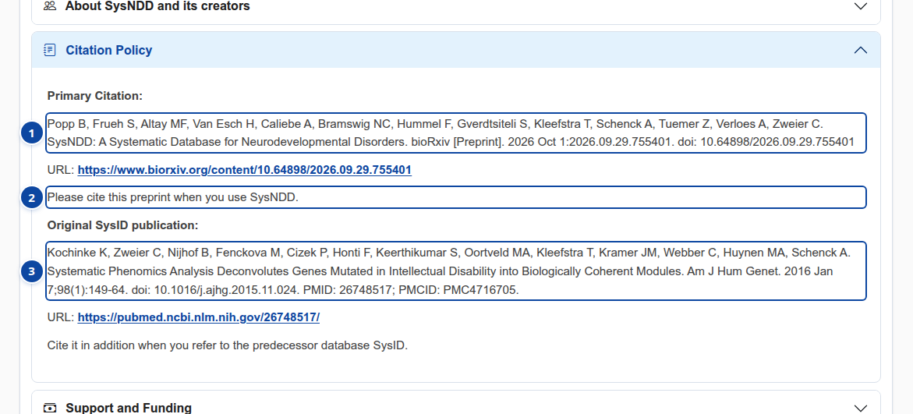
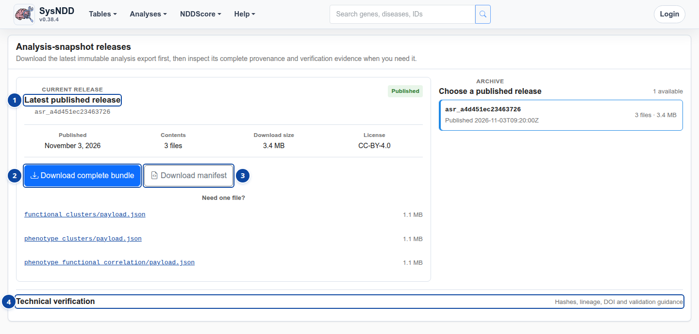

::: {.lead}
How to cite SysNDD in a paper or report, how to state which version of the data you used, and
what the license allows.
:::

::: {.callout-note .who-can title="Who can do this"}
Everyone. No account is needed to cite, download or reuse SysNDD data.
:::

## Cite SysNDD

When you use SysNDD, cite the SysNDD publication [@popp_sysndd_2026]. Copy the current
citation text from the web app, as described below, so that you always use the latest version.

When you refer to the predecessor database SysID, cite in addition the original publication
[@kochinke_systematic_2016].

The web app shows the current citation under **Help › About › Citation Policy**. The **Copy
citation** button in the announcement on the home page copies it as text, if you have not
dismissed the announcement. If a peer-reviewed
article replaces the preprint, both places are updated; use the version shown there.

::: {.doc-screenshot}
{#fig-citing-about-policy fig-alt="The SysNDD About page with the Citation Policy section expanded. Marker 1 points to the SysNDD preprint citation under Primary Citation, marker 2 to the sentence asking you to cite the preprint, marker 3 to the original SysID publication by Kochinke and colleagues."}
:::

::: {.marker-legend}
1. **Primary Citation**: the SysNDD preprint, the citation for any use of SysNDD.
2. The instruction to cite this preprint when you use SysNDD.
3. **Original SysID publication**: cite it in addition when you refer to the predecessor
   database SysID.
:::

## State the version and date you used

SysNDD changes as curators approve new evidence. An entity's evidence category can differ between
two dates. To make your work reproducible, report:

- the **access date**, written out in full (for example, November 20, 2026);
- the **SysNDD version**: the API release number returned by
  `https://sysndd.dbmr.unibe.ch/api/version/`;
- what you used, for example "Definitive entities from **Tables › Panels**" or the API request.

To read the version:

```bash
curl -s "https://sysndd.dbmr.unibe.ch/api/version/"
```

```json
{"version": ["0.38.2"], "title": ["SysNDD API"], ...}
```

The web app also shows its own version below the SysNDD logo in the top bar.

A methods sentence could read: "Gene-disease associations were taken from SysNDD
[@popp_sysndd_2026] (API version 0.38.2, accessed November 20, 2026), using all entities in the
Definitive category." Replace the version and date with your own.

## Find a release

SysNDD publishes two kinds of release.

| Release | What it contains | Where |
| --- | --- | --- |
| Software release | the web app, API and database schema at one version | [GitHub releases](https://github.com/berntpopp/sysndd/releases) |
| Analysis-snapshot release | a fixed export of the derived analyses (functional clusters, phenotype clusters and their correlation) | **Analyses › Data releases** (`/DataReleases`) |

Curated entities are served live. For a fixed copy of curated data, download it on your access
date (see [Get SysNDD data with the API and MCP](03-api.qmd)) and keep the file with your
analysis.

### Download an analysis-snapshot release

An analysis-snapshot release does not change after it is published. Each file carries a
checksum (a fingerprint that changes if the file changes), so you can show that your copy is
unaltered.

As of November 20, 2026, no analysis-snapshot release has been published; the page shows
**No releases published yet**.

::: {.steps}
1. Open **Analyses › Data releases**.
2. Read the **Latest published release** panel: **Published**, **Contents**, **Download size**
   and **Licence**.
3. Select **Download complete bundle** for all files, or **Download manifest** for the file list
   with checksums.
4. To cite a release, open **Technical verification** and copy the **Version DOI** (digital object identifier) if one
   is listed.
:::

::: {.doc-screenshot}
{#fig-citing-data-releases fig-alt="The Analysis-snapshot releases page on a test instance, showing an example release. Marker 1 points to the Latest published release panel, marker 2 to the Download complete bundle button, marker 3 to the Download manifest button, marker 4 to the Technical verification section at the bottom."}
:::

::: {.marker-legend}
1. **Latest published release**: date, contents, size and license of the newest release.
2. **Download complete bundle**: all files of the release in one archive.
3. **Download manifest**: the list of files with their SHA-256 checksums (a standard checksum format).
4. **Technical verification**: hashes, lineage and DOI.
:::

The analyses in a release are derived from the curated data. Treat them as hypotheses, not as
curated facts (see [Explore the analyses](using-analyses.qmd)).

## License

| What | License | What you may do |
| --- | --- | --- |
| SysNDD data | [Creative Commons Attribution 4.0 International (CC BY 4.0)](https://creativecommons.org/licenses/by/4.0/) | copy, share and adapt the data for any purpose, including commercial use, if you give credit |
| SysNDD source code | [MIT No Attribution (MIT-0)](https://github.com/berntpopp/sysndd/blob/master/LICENSE.md) | use, change and redistribute the code without conditions |

Under CC BY 4.0, giving credit means: cite SysNDD as shown above, link to the license, and say
whether you changed the data.

Pages in SysNDD also show data from other resources, such as gnomAD and ClinVar on the gene page.
Those data are not SysNDD curation and remain under the terms of their source.

## Common problems

- **My numbers differ from a published paper.** The paper used an earlier version. Compare the
  versions and access dates; categories change as evidence is approved.
- **The Data releases page says "No releases published yet".** No analysis-snapshot release has
  been published. Cite the API version and access date instead.
- **I need a fixed copy of the curated entities.** Download them with the API or as Excel on your
  access date and archive the file with your work.

## Related pages

- [Get SysNDD data with the API and MCP](03-api.qmd): download the data you cite.
- [Data model](04-database-structure.qmd): what the downloaded fields mean.
- [Curation criteria](05-curation-criteria.qmd): the definitions behind the categories you
  report.
- [References](references.qmd): the full bibliography of this documentation.
