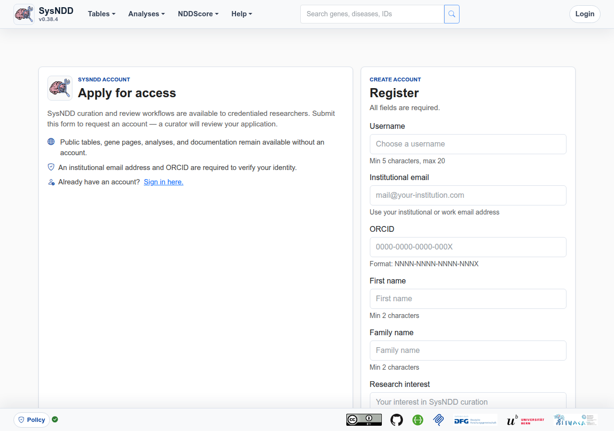
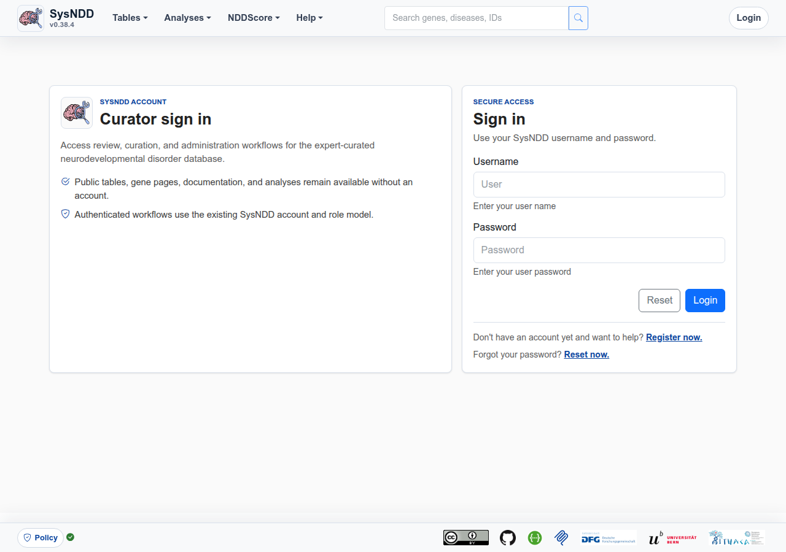
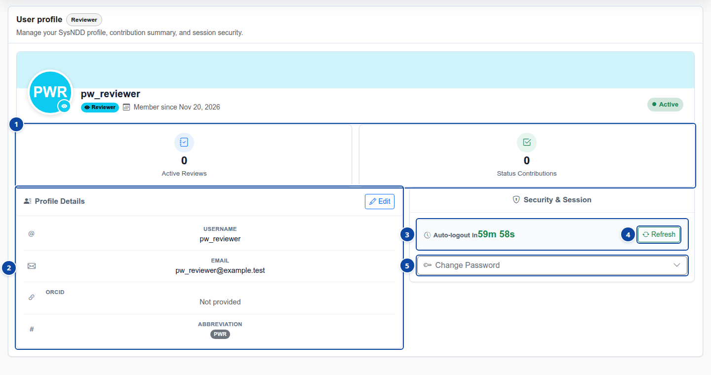
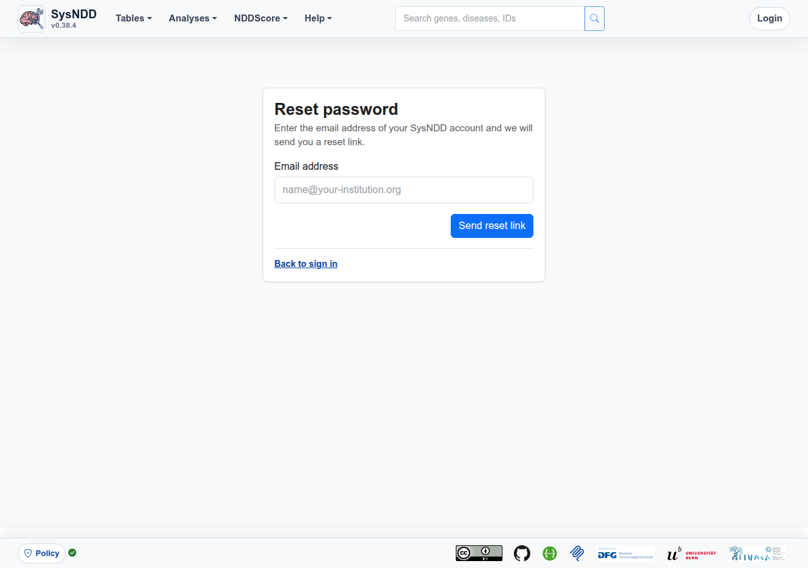
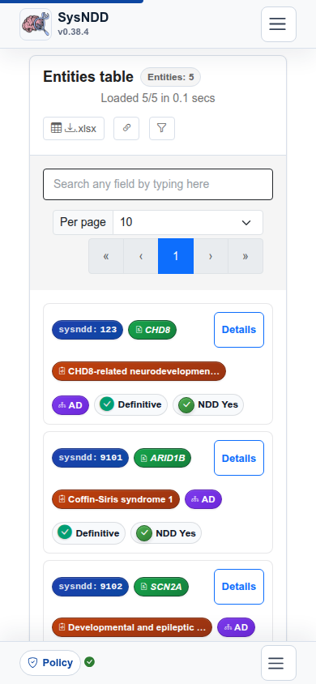

::: {.lead}
Apply for a SysNDD account, sign in, keep your session active, change or reset your password, and use SysNDD on a phone.
:::

::: {.callout-note .who-can title="Who can do this"}
Anyone can apply for an account. You need an account only to review or curate. Searching, browsing, downloading and the analyses work without one.
:::

## Apply for an account

SysNDD accounts are for researchers and clinicians who want to contribute to curation. A Curator checks every application.

::: {.steps}
1. Select **Login** at the right of the navigation bar.
2. Below the sign-in form, select **Register now.** The page **Apply for access** opens (`/Register`).
3. Fill in all fields. The table below lists what each one needs.
4. Check **I accept the terms of use**.
5. Select **Register**.
:::

::: {.doc-screenshot}
{#fig-account-register fig-alt="Apply for access page. On the left, a short explanation of who can apply. On the right, the Register form with fields for username, institutional email, ORCID, first name, family name and research interest, a terms-of-use checkbox, and Reset and Register buttons."}
:::

| Field | What to enter |
| --- | --- |
| **Username** | 5 to 20 characters |
| **Institutional email** | An address at your institution, not a private one. The form checks only the format; the Curator judges whether the address is institutional |
| **ORCID** | Your ORCID identifier, in the form `0000-0000-0000-000X` |
| **First name**, **Family name** | 2 to 50 characters each |
| **Research interest** | Why you want to contribute, 10 to 250 characters |

: Fields of the registration form. {#tbl-account-register-fields}

SysNDD uses your institutional email and ORCID to verify who you are. You receive an email confirming that your request arrived.

When a Curator approves your application, a second email arrives. It contains a temporary password and a link to the sign-in page. The Curator also assigns your role, for example [Reviewer]{.role}. A new account can also start as [Viewer]{.role}, a read-only role that can sign in but cannot review or curate.

## Sign in

::: {.steps}
1. Select **Login** at the right of the navigation bar.
2. Type your **Username** and **Password**.
3. Select **Login**.
:::

::: {.doc-screenshot}
{#fig-account-login fig-alt="Curator sign in page with the Sign in form: Username and Password fields, Reset and Login buttons, and links to register and to reset the password."}
:::

After you sign in, your user name replaces **Login** in the navigation bar. The menus your role allows appear beside it; see [Menus after sign-in](02-web-tool.qmd#menus-after-sign-in).

::: {.callout-warning title="Change the temporary password"}
After your first sign-in, change the temporary password from your approval email. See [Change your password](#change-your-password).
:::

## Keep your session active

For security, a session ends one hour after you sign in or last refresh it. The time left is shown in two places:

- in your user menu, beside **Token**;
- on your profile page, under **Auto-logout in**.

Five, three and one minute before the session ends, a **Session ending soon** message appears in the top-right corner. It disappears after a few seconds.

To extend the session, do one of the following:

- open your user menu and select **Token**;
- on your profile page, select **Refresh**.

::: {.callout-warning title="Save your work before the session ends"}
When the session ends, SysNDD signs you out. Changes in an open form that you have not saved or submitted are lost. Refresh the session before you start a long review.
:::

## View your profile

Open your user menu and select **View profile** (`/User`). The **User profile** page shows your account details, your contribution counts (**Active Reviews** and **Status Contributions**) and the **Security & Session** card.

::: {.doc-screenshot}
{#fig-account-profile fig-alt="User profile page of a Reviewer account. Marker 1 points to the contribution counts, marker 2 to the account details, marker 3 to the Auto-logout in timer, marker 4 to the Refresh button, marker 5 to the Change Password button."}
:::

::: {.marker-legend}
1. Contribution counts: **Active Reviews** and **Status Contributions**.
2. Account details: **Username**, **Email**, ORCID and **Abbreviation**. Your role appears as a badge in the page header.
3. **Auto-logout in**: the time left in this session.
4. **Refresh**: extends the session.
5. **Change Password**: opens the password form.
:::

## Change your password {#change-your-password}

::: {.steps}
1. Open your user menu and select **View profile**.
2. In **Security & Session**, select **Change Password**.
3. Type your **Current Password**.
4. Type the **New Password** and repeat it in **Confirm New Password**.
5. Select **Update Password**.
:::

A new password needs at least 8 characters, with an uppercase letter, a lowercase letter, a number and a special character (`!@#$%^&*`).

## Reset a forgotten password

::: {.steps}
1. Select **Login**.
2. Below the sign-in form, select **Reset now.** The **Reset Password** page opens (`/PasswordReset`).
3. Type the email address you registered with.
4. Select **Submit**.
5. Open the email from SysNDD and select the link in it.
6. Type your new password, repeat it, and select **Submit change**. The new password must meet the rules in [Change your password](#change-your-password).
:::

::: {.doc-screenshot}
{#fig-account-reset fig-alt="Reset Password card with one email field and a Submit button."}
:::

The link in the email can be used once and expires after 1 hour. If it has expired, request a new one.

## Sign out

Open your user menu and select **Sign out**. On a shared computer, always sign out when you finish.

## Use SysNDD on a phone {#use-sysndd-on-a-phone}

SysNDD adapts to small screens. On windows narrower than 1,200 pixels the menus collapse behind a menu button in the navigation bar; on a phone the tables show each entity as a compact card.

::: {.doc-screenshot .mobile}
{#fig-account-mobile-entities fig-alt="SysNDD Entities table at phone width. Each entity is a card with its identifier, gene, disease, inheritance, category and NDD status, one below the other."}
:::

The analysis plots are wide. Turn the phone to landscape to read them.

### Install SysNDD as an app

You can add SysNDD to your phone's home screen or your computer's app list. It then opens in its own window, without the browser's address bar. This is called a progressive web app (PWA).

::: {.steps}
1. Open [SysNDD](https://sysndd.dbmr.unibe.ch/) in your browser.
2. Open the browser menu and choose the install option, for example **Install app** or **Add to Home Screen**.
3. Confirm the browser's prompt.
:::

The wording of the install option depends on your browser and operating system. Chromium-based browsers, such as Chrome and Edge, support installation on most systems; Safari on iOS supports **Add to Home Screen**. The installed app shows the same live data as the website and needs an internet connection.

## Common problems

- **I did not receive the approval email.** Check your spam folder. Applications are checked by hand, so approval can take some days. If nothing arrives, write to support [at] sysndd.org.
- **Login fails.** Check the username, not the email address, and the password. Passwords are case-sensitive. If you still cannot sign in, reset the password.
- **I was signed out while working.** The session ended. Sign in again, and refresh the session during long tasks; see [Keep your session active](#keep-your-session-active).
- **The Review or Curation menu is missing.** Your role does not include it. Ask a Curator or write to support [at] sysndd.org if you need a different role.
- **The password reset link does not work.** It has expired or was already used. Request a new link.

## Related pages

- [Tour of the web app](02-web-tool.qmd): which menus each role sees.
- [Re-review: guide for Reviewers](06-re-review-instructions.qmd): the main task for [Reviewer]{.role} accounts.
- [Approve user accounts](curator-users.qmd): how Curators assess applications and assign roles.

*Checked against SysNDD 0.38.4 on November 21, 2026.*
