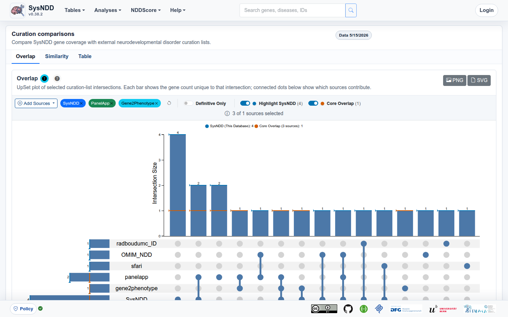
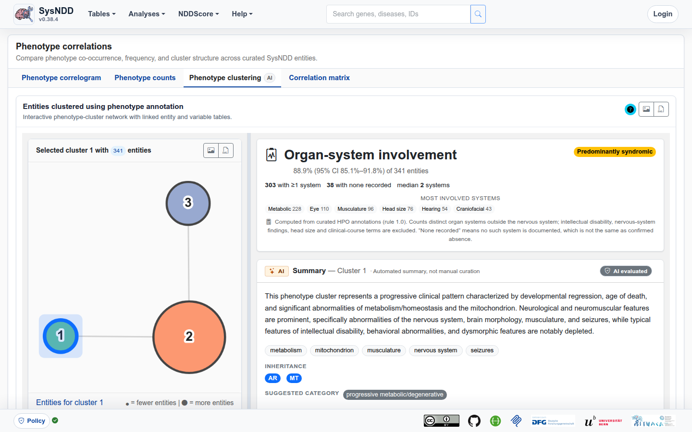
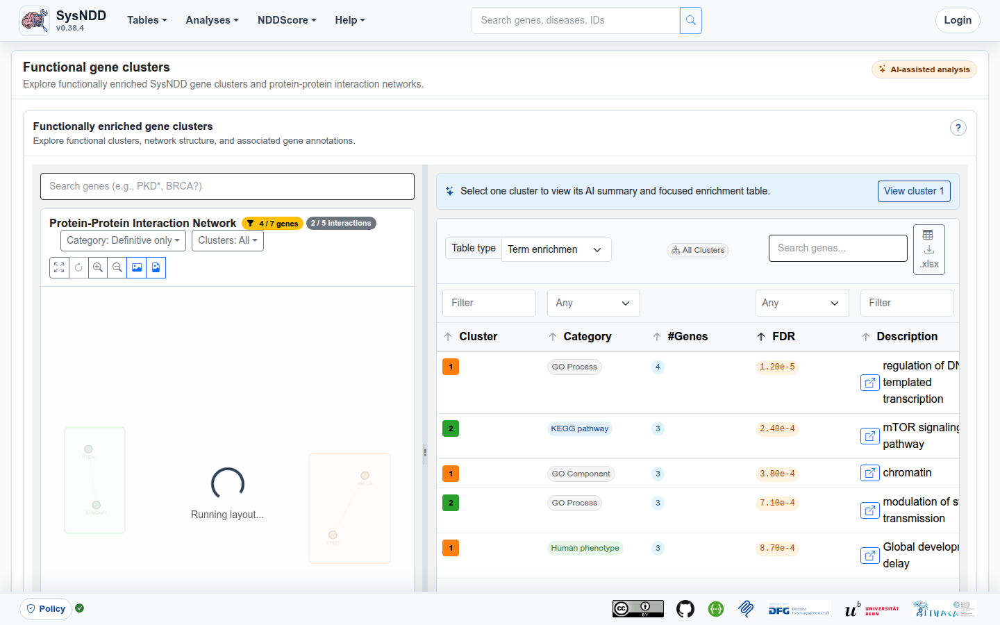

::: {.lead}
The **Analyses** menu summarizes the curated data as plots and tables. They show how SysNDD compares with other gene lists, how phenotypes and genes group together, and how the database and its literature have grown. This chapter explains what each analysis shows and how far you can trust it.
:::

::: {.callout-note .who-can title="Who can do this"}
Everyone. No account is needed.
:::

## Read analyses as hypotheses

The curated facts in SysNDD are the entities, their evidence categories and their reviews. The analyses are computed from those facts. They show patterns worth a closer look, not new curated findings.

Keep three points in mind:

- **Many analyses use a subset.** Several use only [Definitive]{.cat .cat-definitive} entities with NDD Yes, so their numbers differ from the full tables.
- **Clusters are computed groups.** Phenotype clusters and functional clusters come from statistical methods. A different method or a later data version can group entities differently.
- **AI summaries are machine-written.** Some clusters have a summary marked **AI**. A language model wrote it, and a second model checked it against the cluster data. An **AI evaluated** label means the check accepted the summary; **AI evaluated (corrected)** means it also corrected it. **Needs review** means the check had low confidence, and **Rejected** means it rejected the summary. None of these labels means that a curator reviewed the summary.

The clustering analyses are computed at intervals and published as snapshots, so they can lag behind the live tables. For a fixed, citable version, use **Analyses › Data releases** once a release has been published; until then, note the date you accessed the data. See [Cite SysNDD and reuse its data](reference-citing.qmd).

## Compare SysNDD with other curation efforts

**Analyses › Compare curations** (`/CurationComparisons`) compares the genes in SysNDD with other neurodevelopmental disorder (NDD) gene lists, such as Gene2Phenotype, PanelApp, SFARI and the NDD genes in OMIM and Orphanet. The date of the last refresh of these lists appears in the page header.

The page has three tabs:

| Tab | Shows | Use it to |
| --- | --- | --- |
| **Overlap** | An UpSet plot of the genes shared between selected lists | See which genes only one list contains |
| **Similarity** | A matrix of pairwise similarity between the lists | See which lists agree most |
| **Table** | One row per gene, one column per list | Look up one gene across all lists, and download the table |

: Tabs of Compare curations. {#tbl-analyses-compare-tabs}

An UpSet plot replaces a Venn diagram when there are more than three sets. Each column is one combination of lists. The bar above it shows how many genes fall into exactly that combination.

On **Overlap**, select **Add Sources** to change which lists are compared. Switch on **Definitive Only** to compare only the most confident genes of each list.

::: {.doc-screenshot}
{#fig-analyses-compare-overlap fig-alt="Curation comparisons page on the Overlap tab, showing an UpSet plot with bars for gene counts per combination of curation lists."}
:::

Lists use different evidence scales. A gene missing from one list may not have been reviewed there yet. Treat differences as leads to check, not as errors in either list.

## Explore phenotype correlations and clusters

**Analyses › Correlate phenotypes** (`/PhenotypeCorrelations`) has four tabs.

### Phenotype correlogram

A matrix of how often two phenotypes are annotated on the same entities. The color scale beside the matrix shows the strength of each correlation. Select a cell to list the entities the correlation was computed on: Definitive entities with an NDD phenotype that have both phenotypes recorded as present. The list opens in **Phenotype search**, where each of the two phenotypes shows as a filter that starts with **present:**.

### Phenotype counts

A bar chart of how many Definitive entities carry each phenotype. Select a bar to list those entities. [Search by phenotype or variant type](using-phenotype-search.qmd) describes the list that opens.

### Phenotype clustering

Entities are grouped by the similarity of their phenotype annotations. Each bubble on the left is one cluster; its size reflects the number of entities.

::: {.steps}
1. Select a bubble. The page shows the number of entities in the cluster and a link to them in the Entities table.
2. Read the cluster's summary, its **Organ-system involvement** card and its stability card, where available.
3. Under **Table type**, choose which variables to list.
:::

::: {.doc-screenshot}
{#fig-analyses-phenotype-clusters fig-alt="Phenotype clustering tab. On the left, a network of three colored cluster bubbles with cluster 1 selected. On the right, the Organ-system involvement card and the AI summary of cluster 1; the table of variables follows below them."}
:::

The three table types are:

- **Qualitative input variables (phenotypes)**: the phenotypes that define the clusters.
- **Qualitative supplementary variables (inheritance)**: modes of inheritance. They describe the clusters but did not form them.
- **Quantitative supplementary variables (phenotype counts)**: per-entity counts, such as the number of organ systems involved. They also only describe the clusters.

For each variable the table shows a **p-value** and a **v-test** value. A positive v-test means the variable is more common in the cluster than in all entities; a negative value means it is less common. The larger the absolute value, the stronger the difference.

**Organ-system involvement** is counted directly from the curated phenotypes, not written by a model. It reports how many entities in the cluster have at least one organ system involved outside the nervous system. An entity with no recorded system is reported as such; this is not proof that the system is unaffected.

### Correlation matrix

This tab opens **Phenotype–function correlation**, described below.

## Explore functional gene clusters

**Analyses › Functional clusters** (`/GeneNetworks`) groups genes whose products interact, using data from STRING, a database of protein-protein interactions. The clusters are computed from all genes with an NDD entity (NDD Yes), whatever its category. The network first shows only genes with a Definitive entity; use the category filter to add Moderate (**+ Moderate**) and Limited (**+ Limited**) genes.

::: {.steps}
1. Select a cluster in the network, in the cluster legend, or in the cluster list. The tables and the summary switch to that cluster.
2. Under **Table type**, choose **Term enrichment** or **Identifiers**.
3. To return to all clusters, select the empty network background or choose **All Clusters**.
:::

::: {.doc-screenshot}
{#fig-analyses-functional-clusters fig-alt="Functional gene clusters page. On the left, a protein-protein interaction network with genes colored by cluster. On the right, a table of enriched terms with category, number of genes, FDR and description."}
:::

**Term enrichment** lists functions, pathways and phenotype terms that are over-represented in a cluster. **#Genes** is the number of cluster genes with the term. **FDR** is the false discovery rate, a p-value corrected for testing many terms; smaller is stronger. Use the FDR filter to keep only strong results. **Identifiers** lists the cluster's genes with links to their SysNDD gene pages and to STRING.

A functional cluster suggests that its genes act in a shared process. It does not show that they cause the same disorder.

## Compare phenotype and functional clusters

**Analyses › Phenotype–function correlation** (`/PhenotypeFunctionalCorrelation`) shows a heatmap of correlations between phenotype clusters and functional clusters. A strong cell means that entities in one phenotype cluster often involve genes from one functional cluster.

This is the most derived analysis in SysNDD: it compares two sets of computed groups. Use it to generate questions, and check individual entities before drawing conclusions.

## Follow growth over time

**Analyses › Entries over time** (`/EntriesOverTime`) plots the cumulative number of entities or genes since curation began. Choose what to count and how to split the lines, for example by evidence category or by inheritance. Hover over a line to see the count at a date.

## Explore the literature

### NDD Publications

**Analyses › NDD Publications** (`/PublicationsNDD`) lists the publications cited by SysNDD entities. It has three tabs:

- **SysNDD Curated**: the searchable table of publications.
- **Time Plot**: publications by year.
- **Stats**: summary statistics of the publications.

### PubTator Analysis

**Analyses › PubTator Analysis** (`/PubtatorNDD`) uses PubTator, a service of the US National Center for Biotechnology Information that marks genes and diseases in PubMed abstracts. It finds genes mentioned in NDD publications. It has three tabs:

- **Table**: the publications and the genes found in them.
- **Genes**: genes ranked by how strongly they are linked to NDD publications. Genes marked **Literature Only** are mentioned in NDD publications but have no SysNDD entity.
- **Stats**: summary statistics.

A **Literature Only** gene is a candidate for curation, not evidence of a disease association. Automated text mining can mistake a gene name or link a gene to a disease it was only compared with.

## Common problems

- **A plot is empty or shows an error.** The analysis data are loading or temporarily unavailable. Reload the page after a minute.
- **The numbers differ from the Entities table.** Several analyses use only Definitive NDD entities, and the cluster analyses come from a dated snapshot. Their numbers are not comparable with the full tables.
- **The cluster numbers changed.** Clusters are recomputed for each snapshot, and cluster numbers are labels, not identities. Compare clusters by their genes or phenotypes, not by number.
- **Plots are cramped on a phone.** Turn the phone to landscape, or use a larger screen.

## Related pages

- [Search by phenotype or variant type](using-phenotype-search.qmd): the entity lists that open from the plots.
- [Find a gene](using-find-gene.qmd): read the entities behind a cluster.
- [Cite SysNDD and reuse its data](reference-citing.qmd): fixed versions of the analysis data.
- [Get SysNDD data with the API and MCP](03-api.qmd): request the analysis data from code.
- [Glossary](reference-glossary.qmd): terms such as phenotype cluster, functional cluster and NDDScore.

*Checked against SysNDD 0.38.4 on November 21, 2026.*
