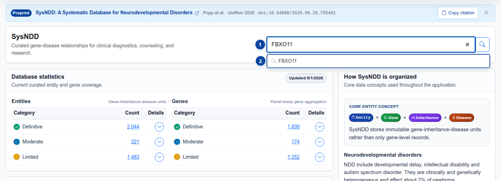
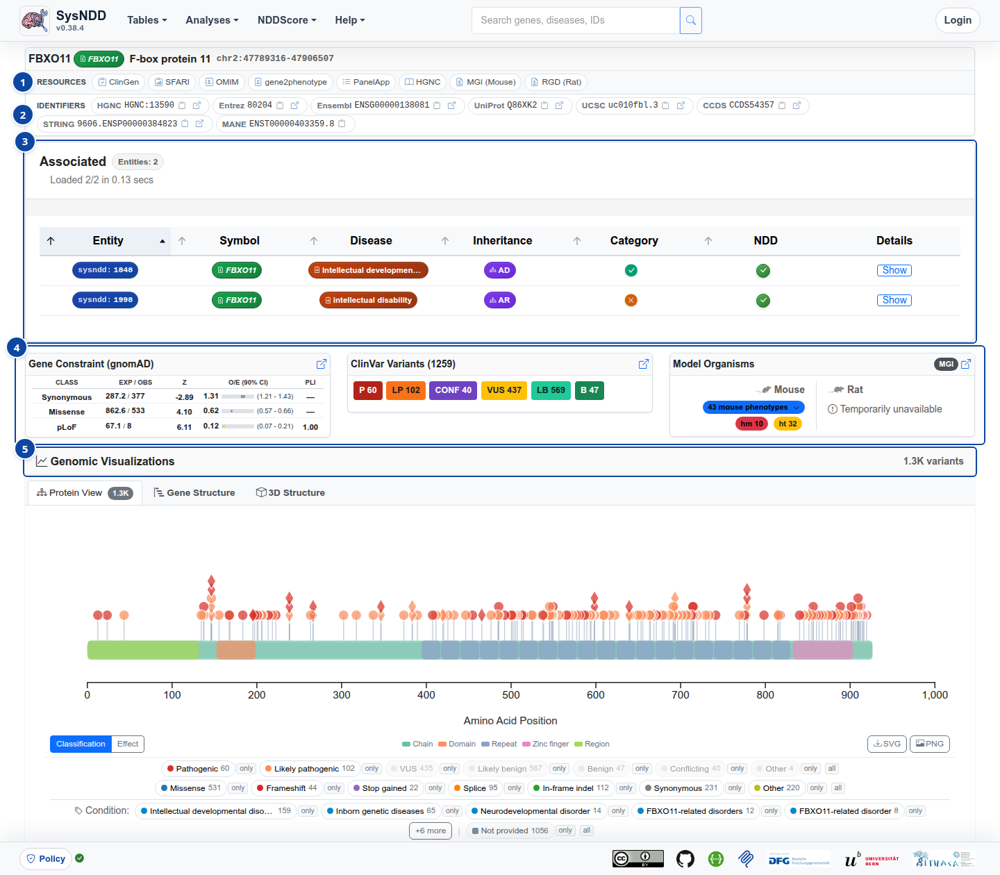
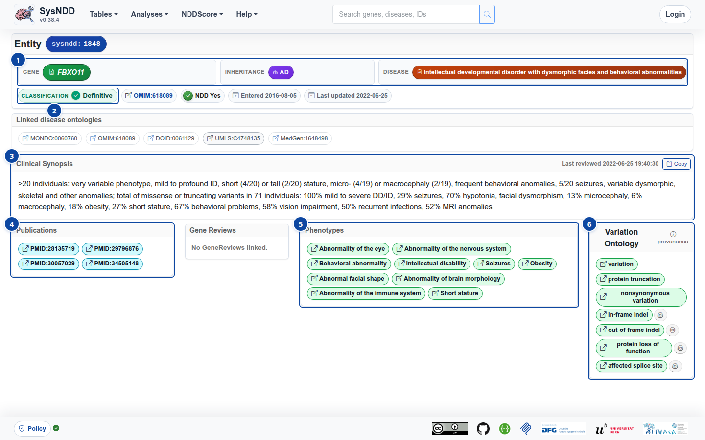
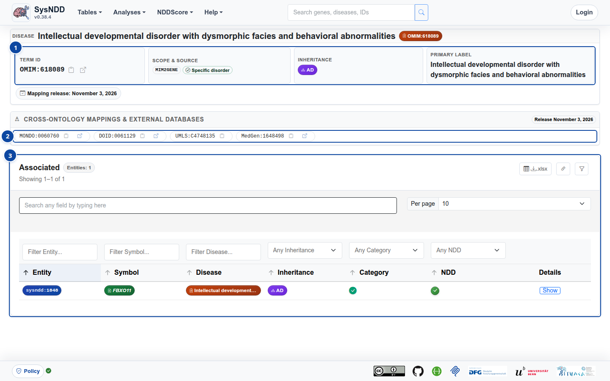

::: {.lead}
Search for a gene, disease or identifier, then read the gene page, the entity page and the disease page to see what SysNDD has curated.
:::

::: {.callout-note .who-can title="Who can do this"}
Everyone. No account is needed.
:::

This chapter uses *FBXO11* as the example. It has two entities: an autosomal dominant disorder graded [Definitive]{.cat .cat-definitive} and an autosomal recessive association graded [Refuted]{.cat .cat-refuted}. [What is SysNDD](01-intro.qmd) explains why one gene can have several entities.

## Search for a gene, disease or identifier

The search box accepts gene symbols, disease names, disease identifiers (OMIM or MONDO) and SysNDD entity identifiers.

::: {.steps}
1. On the home page, select the box **Search genes, diseases, IDs**. On other pages, use the search box in the navigation bar.
2. Type the start of a gene symbol, for example `FBXO11`. Suggestions appear below the box.
3. Select a suggestion, or press <kbd>Enter</kbd>.
:::

::: {.doc-screenshot}
{#fig-find-gene-search fig-alt="SysNDD home page. Marker 1 points to the search box containing the text FBXO11, marker 2 to the first entry in the suggestion list below it."}
:::

::: {.marker-legend}
1. **Search genes, diseases, IDs**: type a gene symbol, disease name or identifier.
2. Suggestion list: select an entry to open its page directly.
:::

If your text exactly matches a gene symbol or disease identifier, SysNDD opens that page directly. The match ignores upper and lower case, so `fbxo11` also opens the gene page for *FBXO11*.

Otherwise SysNDD opens **Search Results**. Each row shows the **Match**, its **Type** (**Gene Symbol**, **Entity ID**, **Disease ID** or **Disease Name**), the entity it belongs to, and a **Relevance** rating from **Excellent** to **Partial**. Select a row to open it.

::: {.callout-tip}
To open an entity you already know, type its number, for example `1848`, and select the **Entity ID** row in **Search Results**. A number never opens the entity directly, because similar numbers also match. You can also go to `https://sysndd.dbmr.unibe.ch/Entities/1848`.
:::

## Read a gene page

The gene page brings together everything SysNDD holds for one gene. Its address is `/Genes/` followed by the symbol, for example `/Genes/FBXO11`.

::: {.doc-screenshot}
{#fig-find-gene-gene-page fig-alt="Gene page for FBXO11. Marker 1 points to the Resources row of external links, marker 2 to the Identifiers row, marker 3 to the Associated entities table with two rows, marker 4 to the Gene Constraint (gnomAD), ClinVar Variants and Model Organisms cards, marker 5 to the Genomic Visualizations panel."}
:::

::: {.marker-legend}
1. **Resources**: links to the gene in ClinGen, SFARI, OMIM, gene2phenotype, PanelApp, HGNC, **MGI (Mouse)** and **RGD (Rat)**.
2. **Identifiers**: the gene's identifiers in HGNC, Entrez, Ensembl, UniProt, UCSC, CCDS, STRING and **MANE** (the MANE Select transcript).
3. **Associated** entities: every SysNDD entity for this gene, with inheritance, evidence category and NDD column (Yes/No).
4. **Gene Constraint (gnomAD)**, **ClinVar Variants** and **Model Organisms**: data from external resources.
5. **Genomic Visualizations**: **Protein View**, **Gene Structure** and **3D Structure**, with ClinVar variants drawn on the protein and gene.
:::

Read the entity table first. It holds the curated statements. For *FBXO11* it has two rows, `sysndd:1848` (autosomal dominant, Definitive) and `sysndd:1998` (autosomal recessive, Refuted). The category belongs to each entity, not to the gene.

The cards and plots below the table show data from gnomAD, ClinVar, MGI, RGD, UniProt and AlphaFold. SysNDD does not curate these data. They load from the external sources, and a card shows an error when its source is unavailable.

## Read an entity page

The entity page shows the curated record for one gene, inheritance and disease. Select the `sysndd:` badge in any table to open it. Its address is `/Entities/` followed by the number.

::: {.doc-screenshot}
{#fig-find-gene-entity-page fig-alt="Entity page for sysndd:1848. Marker 1 points to the Gene, Inheritance and Disease fields at the top, marker 2 to the Classification badge reading Definitive, marker 3 to the Clinical Synopsis card, marker 4 to the Publications and Gene Reviews cards, marker 5 to the Phenotypes card, marker 6 to the Variation Ontology card."}
:::

::: {.marker-legend}
1. **Gene**, **Inheritance**, **Disease**: the three parts of the entity. Inheritance is abbreviated, for example AD (autosomal dominant) or AR (autosomal recessive). The disease identifier and the NDD column (Yes/No) appear beside them, with the dates the entity was **Entered** and **Last updated**. The **Linked disease ontologies** card lists the same disease in MONDO, OMIM, the Disease Ontology (DOID), UMLS and MedGen.
2. **Classification**: the evidence category.
3. **Clinical Synopsis**: the curators' summary of the reported phenotype, with the date it was **Last reviewed**. **Copy** copies the text.
4. **Publications** and **Gene Reviews**: the PubMed identifiers (PMIDs) the review is based on. Each opens in PubMed.
5. **Phenotypes**: the HPO terms annotated for the entity.
6. **Variation Ontology**: the variant types reported, as Variation Ontology (VariO) terms.
:::

To judge a [Limited]{.cat .cat-limited} or [Moderate]{.cat .cat-moderate} entity, read the synopsis and the publications. The [curation criteria](05-curation-criteria.qmd) explain what each category requires.

### Machine-derived variant types

Some Variation Ontology terms were imported from an external source or extracted from the literature, not entered by a curator. These terms have a provenance button beside them. It shows whether a curator has confirmed the term (**Confirmed by a curator** or **Not yet confirmed by a curator**) and lists the evidence. Select **provenance** in the card header for an explanation. Terms without a provenance button were entered by a curator.

## Read a disease page

The disease page lists every SysNDD entity for one disease identifier. Select a disease name in any table to open it. Its address is `/Ontology/` followed by the identifier, for example `/Ontology/OMIM:618089`.

::: {.doc-screenshot}
{#fig-find-gene-disease-page fig-alt="Disease page for OMIM:618089. Marker 1 points to the disease identifier, name and inheritance at the top, marker 2 to the linked identifiers in other ontologies, marker 3 to the Associated entities table with one row for FBXO11."}
:::

::: {.marker-legend}
1. Disease identifier, name and mode of inheritance (abbreviated, for example AD).
2. Linked identifiers for the same disease in other ontologies, such as the Disease Ontology (DOID) and MONDO.
3. **Associated** entities: every entity with this disease.
:::

A disease page is useful for genetically heterogeneous disorders. It shows all genes SysNDD links to one disease identifier.

## Browse the Entities and Genes tables

To scan many records at once, use the tables instead of the search.

::: {.steps}
1. Open **Tables › Entities** for one row per entity, or **Tables › Genes** for one row per gene.
2. Type a symbol or disease in **Search any field by typing here**, or use the column filters.
3. Select **.xlsx** to download the rows that match.
:::

The controls are described in [Work with tables](02-web-tool.qmd#work-with-tables).

::: {.callout-note}
The Entities table includes Refuted and Not applicable entities. To list only established associations, choose **Definitive** in the **Any Category** filter.
:::

## Common problems

- **The search opens a results list instead of the gene.** The text did not match a symbol exactly, for example because of a typo or an old gene symbol. Pressing <kbd>Enter</kbd> before the suggestions appear also opens the results list. Choose the matching row, or search for the HGNC-approved symbol.
- **The results show similar symbols but not my gene.** SysNDD searches only genes with at least one curated entity, so it offers the closest symbols instead. A gene missing from SysNDD has not been curated; this does not mean it has no disease association.
- **A card on the gene page shows an error.** The external source did not respond. Reload the page later. The curated entity table is not affected.
- **A gene has an entity graded Refuted.** This refers to that entity only. Check the other entities of the gene; *FBXO11* has a Definitive one.

## Related pages

- [What is SysNDD](01-intro.qmd): the entity concept and the evidence categories.
- [Build a gene panel](using-panels.qmd): turn your search into a downloadable gene list.
- [Search by phenotype or variant type](using-phenotype-search.qmd): find entities by clinical features.
- [Curation criteria](05-curation-criteria.qmd): what each evidence category requires.

*Checked against SysNDD 0.38.2 on November 20, 2026.*
