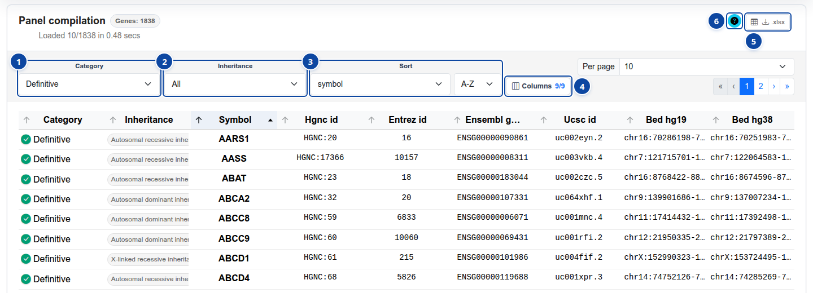

::: {.lead}
Build a list of NDD genes filtered by evidence category and mode of inheritance, and download it as an Excel file to filter sequencing variants in your own tools.
:::

::: {.callout-note .who-can title="Who can do this"}
Everyone. No account is needed.
:::

## How a panel is built

A panel is a list of **genes**, while SysNDD grades **entities**. The Panels page turns entities into genes with three rules:

- Only entities with NDD **Yes** count (the NDD column; see [What is SysNDD](01-intro.qmd#the-ndd-column)). Non-NDD entities, which are normally marked [Not applicable]{.cat .cat-na}, are left out.
- Each gene gets the **highest** evidence category of its entities. A gene with one Definitive and one Limited entity is a Definitive gene.
- The **Inheritance** column lists the modes of inheritance of the gene's entities, separated by semicolons.

*ARID1B* has one entity, Coffin-Siris syndrome 1 with autosomal dominant inheritance, graded [Definitive]{.cat .cat-definitive}. It appears in the Definitive panel with "Autosomal dominant inheritance".

## Build a panel

::: {.steps}
1. Open **Tables › Panels** (`/Panels/All/All`). The page is titled **Panel compilation** and opens with all categories.
2. In **Category** [1]{.marker}, choose **All**, **Definitive**, **Moderate**, **Limited** or **Refuted**, for example **Definitive**.
3. In **Inheritance** [2]{.marker}, choose **All**, **Autosomal dominant**, **Autosomal recessive**, **X-linked** or **Other**.
4. Optional: in **Sort** [3]{.marker}, choose the column to sort by and **A-Z** or **Z-A**.
5. Optional: select **Columns** [4]{.marker} to choose which columns the table shows.
6. Select **.xlsx** [5]{.marker} to download the panel.
:::

::: {.doc-screenshot}
{#fig-panels-filters fig-alt="Panel compilation page. Marker 1 points to the Category list set to Definitive, marker 2 to the Inheritance list, marker 3 to the Sort controls, marker 4 to the Columns button, marker 5 to the .xlsx download button, marker 6 to the help badge beside the title."}
:::

::: {.marker-legend}
1. **Category**: the evidence category of the genes in the panel. **Refuted** gives genes whose only NDD entities are refuted. Do not use it for a diagnostic panel.
2. **Inheritance**: keeps genes with an entity of this mode of inheritance.
3. **Sort**: the column and direction the table is sorted by.
4. **Columns**: shows or hides table columns. The gene symbol is always shown.
5. **.xlsx**: downloads the whole panel as `sysndd_panels.xlsx`.
6. Help badge: explains how genes are assigned to categories.
:::

The count beside the title, **Genes**, shows how many genes the panel holds.

To reopen a panel later, use its address: `/Panels/` followed by the category and the inheritance, for example `https://sysndd.dbmr.unibe.ch/Panels/Definitive/All`. Spaces in an inheritance name are written `%20`, as in `/Panels/Definitive/Autosomal%20dominant`.

## Read the downloaded file

The Excel file has three sheets:

| Sheet | Contents |
| --- | --- |
| `data` | One row per gene |
| `meta` | The query: filter, sort, number of rows and the time it took |
| `links` | Technical links to the same query in the API |

: Sheets in the panel download. {#tbl-panels-sheets}

The `data` sheet always contains all columns, whatever you chose under **Columns**:

| Column | Meaning |
| --- | --- |
| `category` | The gene's highest evidence category |
| `inheritance` | Modes of inheritance of the gene's entities |
| `symbol`, `hgnc_id` | HGNC gene symbol and identifier |
| `entrez_id`, `ensembl_gene_id`, `ucsc_id` | Gene identifiers in NCBI Gene, Ensembl and UCSC |
| `bed_hg19`, `bed_hg38` | Gene coordinates (`chr:start-end`) on GRCh37 (hg19) and GRCh38 (hg38) |

: Columns in the data sheet. {#tbl-panels-columns}

Keep the `meta` sheet with your analysis. It records exactly which query produced the list. Note the download date yourself; neither the file nor its name records it. For a citable version of the data, see [Cite SysNDD and reuse its data](reference-citing.qmd).

## Check a gene's entities before you rely on the panel

The **Category** and **Inheritance** filters work on different things. **Category** uses the gene's highest category. **Inheritance** keeps a gene if *any* of its NDD entities has that mode of inheritance, whatever that entity's category.

::: {.callout-warning title="A gene can appear with an inheritance its top category does not support"}
*FBXO11* has a [Definitive]{.cat .cat-definitive} autosomal dominant entity and a [Refuted]{.cat .cat-refuted} autosomal recessive entity. Its highest category is Definitive, and one of its entities is autosomal recessive. It therefore appears in the panel **Definitive** + **Autosomal recessive**, although the recessive association is refuted. Its `inheritance` cell in the **All** panel reads "Autosomal dominant inheritance; Autosomal recessive inheritance".

In a panel filtered by inheritance, the **Inheritance** column and the `inheritance` cell show only the chosen mode. In **Definitive** + **Autosomal recessive**, *FBXO11* reads just "Autosomal recessive inheritance", so the file does not reveal the conflict.

The same applies to entities that are not graded. The inheritance filter can match any entity with NDD Yes, including one marked Not applicable. On November 20, 2026, *PPOX* had a Not applicable autosomal dominant entity with NDD Yes; it therefore appeared in **Definitive** + **Autosomal dominant** with "Autosomal dominant inheritance", although its only graded entity is autosomal recessive and Definitive.
:::

For a variant-filtering panel by inheritance, check the entities of the genes you rely on:

::: {.steps}
1. Open **Tables › Entities**.
2. In the **Any Category** filter, choose the category you need.
3. In the **Any Inheritance** filter, choose the mode of inheritance.
4. Select **.xlsx** to download the matching entities.
:::

This list has one row per entity, so each row pairs one category with one mode of inheritance. [Find a gene](using-find-gene.qmd#browse-the-entities-and-genes-tables) describes the Entities table.

## Common problems

- **A gene I expected is missing.** It may have only entities with NDD No, or none in the chosen category. Search for it to see its entities; see [Find a gene](using-find-gene.qmd).
- **The download has more columns than the table.** This is expected. The file always contains all columns.
- **The panel URL I bookmarked opens the full list.** The address accepts only the categories and inheritance names shown in the lists. Any other value opens `/Panels/All/All`.
- **The counts change between downloads.** Curators add and update entities continuously. Keep the `meta` sheet and note the download date. Once a data release has been published under **Analyses › Data releases**, cite it for a fixed version.

## Related pages

- [What is SysNDD](01-intro.qmd): entities, evidence categories and Not applicable.
- [Curation criteria](05-curation-criteria.qmd): what each evidence category requires.
- [Find a gene](using-find-gene.qmd): check individual genes and their entities.
- [Get SysNDD data with the API and MCP](03-api.qmd): request the same panels from code.
- [Cite SysNDD and reuse its data](reference-citing.qmd): fixed, citable versions of the data.

*Checked against SysNDD 0.38.2 on November 20, 2026.*
