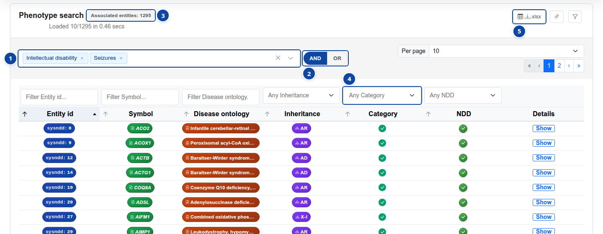
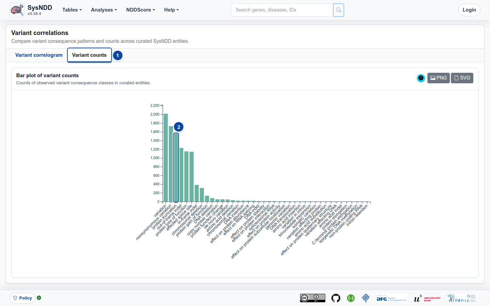

::: {.lead}
Find the entities whose curated annotations include a set of clinical features or a type of variant, for example to build a differential diagnosis or to compare disorders.
:::

::: {.callout-note .who-can title="Who can do this"}
Everyone. No account is needed.
:::

## What you can search

Curators annotate each entity with **phenotypes** and **variant types**:

- Phenotypes are terms from the Human Phenotype Ontology (HPO). SysNDD uses a fixed set of broad HPO terms, such as Intellectual disability, Seizures or Microcephaly, so that entities can be compared.
- Variant types are terms from the Variation Ontology (VariO), such as protein truncation or nonsynonymous variation.

The searches below find entities by these annotations. They do not search the clinical synopsis text or the literature.

## Find entities with a combination of phenotypes

::: {.steps}
1. Open **Tables › Phenotypes**. The page is titled **Phenotype search**. Intellectual disability is preselected.
2. Select the arrow at the right of the phenotype box [1]{.marker} (screen readers announce it as **Add phenotype filter**) to open the list.
3. Type part of a term in **Search phenotypes...**, for example `Seizures`, and select it. Add more terms the same way.
4. Choose **AND** or **OR** [2]{.marker} beside the phenotype box.
5. Read the result count, **Associated entities** [3]{.marker}, and the table below. To keep only one evidence category, use **Any Category** [4]{.marker}; to download the result, select **.xlsx** [5]{.marker}.
:::

::: {.doc-screenshot}
{#fig-phenotype-search-and-or fig-alt="Phenotype search page. Marker 1 points to the phenotype box containing the terms Intellectual disability and Seizures, marker 2 to the AND and OR buttons with AND active, marker 3 to the Associated entities count, marker 4 to the Any Category filter above the table, marker 5 to the .xlsx download button."}
:::

::: {.marker-legend}
1. Phenotype box: the selected terms. Select the × on a term to remove it, or the larger × at the right end of the box, left of the arrow, to remove all terms.
2. **AND** / **OR**: how the selected terms are combined.
3. **Associated entities**: the number of entities that match.
4. **Any Category**: limits the results to one evidence category.
5. **.xlsx**: downloads the matching entities as an Excel file.
:::

**AND** and **OR** change the result in opposite directions:

| Choice | Shows entities annotated with | Effect of adding a term |
| --- | --- | --- |
| **AND** | every selected phenotype | fewer results |
| **OR** | at least one selected phenotype | more results |

: How AND and OR combine phenotypes. {#tbl-phenotype-search-logic}

*ARID1B* is an example. Its entity, Coffin-Siris syndrome 1, is annotated with both Intellectual disability and Seizures. It appears when you search for these two terms with **AND**, and also with **OR**.

::: {.callout-tip}
The results include every evidence category, including Refuted and Not applicable entities. Choose **Definitive** in **Any Category** to see only established associations.
:::

## Start from the phenotype analyses

The phenotype analyses link back to this search.

::: {.steps}
1. Open **Analyses › Correlate phenotypes**.
2. On the **Phenotype counts** tab, select a bar to list the Definitive entities annotated with that phenotype.
3. On the **Phenotype correlogram** tab, select a cell to list the Definitive entities with an NDD phenotype that have both phenotypes of that cell recorded as present.
:::

Each selection opens **Phenotype search** with the filter already set. [Read the analyses](using-analyses.qmd) explains the plots.

## Find entities by variant type

There is no separate table for variant types. You reach the matching entities from the variant analyses.

::: {.steps}
1. Open **Analyses › Correlate variants**.
2. Select the **Variant counts** tab [1]{.marker}. Each bar is one variant type, with the number of Definitive entities annotated with it.
3. Select a bar [2]{.marker}. The **Entities** table opens with the Definitive entities annotated with that variant type.
:::

::: {.doc-screenshot}
{#fig-phenotype-search-variant-counts fig-alt="Variant correlations page. Marker 1 points to the Variant counts tab, marker 2 to one bar of the bar chart."}
:::

::: {.marker-legend}
1. **Variant counts**: the bar chart of variant types.
2. A bar: select it to open the matching Definitive entities.
:::

On the **Variant correlogram** tab, selecting a cell opens the Definitive entities with an NDD phenotype that are annotated with *both* variant types of that cell. These are the entities the correlation was computed on.

## Common problems

- **The table shows Intellectual disability although I did not choose it.** It is preselected. Remove it from the phenotype box, or select the × at the right end of the box to remove all terms.
- **A specific HPO term is not in the list.** SysNDD annotates a fixed set of broad terms. Choose the broader term that contains your feature, for example Abnormality of the eye.
- **AND returns no entities.** No entity is annotated with all the selected terms. Remove a term or switch to **OR**.
- **A known disorder is missing from the results.** Phenotype annotations summarize the published reports and may not list every feature. Read the entity's clinical synopsis; see [Find a gene](using-find-gene.qmd#read-an-entity-page).

## Related pages

- [Find a gene](using-find-gene.qmd): read the entity page behind a result.
- [Read the analyses](using-analyses.qmd): phenotype and variant correlations and clusters.
- [Work with tables](02-web-tool.qmd#work-with-tables): sorting, filters, links and downloads.
- [Glossary](reference-glossary.qmd): HPO, VariO and other terms.

*Checked against SysNDD 0.38.4 on November 21, 2026.*
